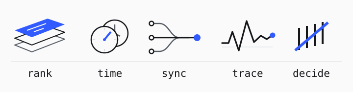

# PGG Engineering tools

Choose a tool by the operation your application needs. Each entry links to its source and a working example. [Open the interactive tool index](https://pgg898200-ship-it.github.io/cachepin/tools/) · [Browse the editable artwork](docs/product-art/README.md).

Follow [runnable examples and measured results](https://pgg898200-ship-it.github.io/cachepin/releases.atom), or [import the portfolio’s release feeds into your reader (OPML)](https://pgg898200-ship-it.github.io/cachepin/releases.opml).

## Search and retrieval

Can a retriever replace its list? RankPatch updates the current winners after each revision. If retrievers only append stable pages, RankSeal can prove the final order. RankFence can use a map of disjoint document IDs to stop reading individual shards.

| Product | What it does | Where it fits | Try it |
| --- | --- | --- | --- |
| [RankPatch](https://github.com/pgg898200-ship-it/rankpatch) | Replace a source’s ranked list and read the revised top k. | In the results aggregator for a long-lived query. A source can revise or withdraw its contribution. | [Live rank fusion](https://huggingface.co/spaces/pgg-engineering/rankpatch) · [Stream LangChain results](https://github.com/pgg898200-ship-it/rankpatch/tree/main/integrations/langchain) |
| [RankSeal](https://huggingface.co/spaces/pgg-engineering/rankseal/tree/main) | Prove the ordered top k while weighted reciprocal rank fusion (RRF) results arrive in pages. | Between retriever cursors and the answer. The auditor can exhibit two possible completions if the order is undecided. | [Audit two rankings](https://huggingface.co/spaces/pgg-engineering/rankseal) |
| [RankFence](https://github.com/pgg898200-ship-it/streamsieve/tree/rankfence-mcp-0.1.0) | Stop paged RRF when a shard map rules out the remaining challengers. | In the retrieval coordinator, where you know which sources can contain the same document. | [Shard-map workbench](https://rankfence-pgg.tancurl3.chatgpt.site/workbench.html) |

## LLM serving and workflow latency

| Product | What it does | Where it fits | Try it |
| --- | --- | --- | --- |
| [CachePin](https://github.com/pgg898200-ship-it/cachepin) | Build reusable prompt prefixes and choose cache breakpoints. | In the request builder or proxy before calls reach the inference provider. | [Cache simulator](https://pgg898200-ship-it.github.io/cachepin/) |
| [Prefix Atlas](https://github.com/pgg898200-ship-it/cachepin/tree/main/tools/prefix-atlas) | Find the cache capacity needed for a target prefix hit rate. | Offline, between a serving trace and a KV-cache sizing decision. The curve models serial prefix LRU. | [Capacity calculator](https://huggingface.co/spaces/pgg-engineering/prefix-atlas) |
| [Cutstream](https://github.com/pgg898200-ship-it/cachepin/tree/main/cutstream) | Catch a literal stop string even when it spans response chunks. | In a model gateway, after decoding chunks and before emitting safe bytes to the client. | [Gateway adapter](https://github.com/pgg898200-ship-it/cachepin/blob/main/cutstream/examples/gateway.py) |
| [EventFold](https://github.com/pgg898200-ship-it/backfold/tree/eventfold-v0.1/companions/eventfold) | Send byte-exact SSE frames as edits to the previous frame. | On a private gateway-to-gateway hop. Decode before passing standard server-sent events to the client. | [SSE inspector](https://huggingface.co/spaces/pgg-engineering/eventfold) |
| [Racecurve](https://github.com/pgg898200-ship-it/cachepin/tree/racecurve) | Choose when to launch a backup request from paired latency traces. | Offline, before configuring a hedge delay. Compare held-out deadlines and extra requests. | [Hedge-delay explorer](https://huggingface.co/spaces/pgg-engineering/racecurve) · [Recompute deadline misses in Colab](https://colab.research.google.com/github/pgg898200-ship-it/cachepin/blob/racecurve/experiments/shared-slots/hedging-under-load.ipynb) |
| [PathProbe DAG](https://github.com/pgg898200-ship-it/causalsieve/tree/main/tools/pathprobe) | Calculate how changing one task duration affects workflow completion time. | After capturing a dependency graph and task timings, before prioritizing work on parallel calls. | [Critical-path explorer](https://huggingface.co/spaces/pgg-engineering/pathprobe-dag) |

## State replication and event routing

| Product | What it does | Where it fits | Try it |
| --- | --- | --- | --- |
| [Afterkey](https://github.com/pgg898200-ship-it/streamsieve/tree/main/afterkey) | Return the latest value or deletion for each key changed since a cursor. | Between a fixed-key state store and a dashboard or worker that polls independently. | [Catch-up demo](https://huggingface.co/spaces/pgg-engineering/afterkey) · [Run the C++ example](https://godbolt.org/z/Tz3sP7KMj) |
| [Tailstate](https://github.com/pgg898200-ship-it/streamsieve/tree/afterkey-tailstate-0.1.0/afterkey/companions/tailstate) | Page through changed keys in sequence order after a worker reconnects. | At a bounded, dense-key publisher. Each reader resumes from its last acknowledged cursor. | [Reconnect example](https://github.com/pgg898200-ship-it/streamsieve/blob/afterkey-tailstate-0.1.0/afterkey/companions/tailstate/examples/reconnect.py) |
| [SinceKit](https://huggingface.co/spaces/pgg-engineering/sincekit/tree/main) | Prepare one changed-key array for readers at different revisions. | In a simulation tick or fleet monitor. Each reader applies a prefix of the shared array. | [Cursor workbench](https://huggingface.co/spaces/pgg-engineering/sincekit) |
| [Guardshift](https://github.com/pgg898200-ship-it/chronosieve/tree/releases/guardshift/guardshift) | Report which conditions turned on or off after a batch of signal changes. | Between a signal update and the dispatcher that wakes workers on state transitions. | [Guard explorer](https://huggingface.co/spaces/pgg-engineering/guardshift) · [Run the C++ example](https://godbolt.org/z/d5jYnjzKW) |
| [KthWake](https://github.com/pgg898200-ship-it/chronosieve/tree/releases/kthwake-0.1.0/companions/kthwake) | Report when a count crosses a threshold inside a sliding time window. | In an ordered event loop. Use the next expiration to wake the loop during silence. | [Arrival timeline](https://pgg-kthwake.tancurl3.chatgpt.site/) · [Run the C++ example](https://godbolt.org/z/no6T73qfr) |
| [Pulsefold](https://github.com/pgg898200-ship-it/streamsieve/tree/pulsefold-v0.1.0/pulsefold) | Track when heartbeats go stale for readers with different deadlines. | Between heartbeat ingestion and routing, failure handling, or dashboards. | [Heartbeat replay](https://huggingface.co/spaces/pgg-engineering/pulsefold) |
| [EdgeChime](https://github.com/pgg898200-ship-it/streamsieve/tree/main/edgechime) | Return the rectangular zones a moving point just entered or left. | After each position update in a simulation or geofencing service. | [Zone explorer](https://huggingface.co/spaces/pgg-engineering/edgechime) · [Try it in Leaflet](https://pgg898200-ship-it.github.io/cachepin/edgechime/) |

## Telemetry, time series and forecasts

| Product | What it does | Where it fits | Try it |
| --- | --- | --- | --- |
| [Backfold](https://github.com/pgg898200-ship-it/backfold) | Correct or retract an old event and update an online statistic. | Between an editable event history and consumers of its current or forked estimates. | [Streaming playground](https://pgg898200-ship-it.github.io/backfold/) |
| [StreamSieve](https://github.com/pgg898200-ship-it/streamsieve) | Sift many numeric channels and return a brief with drill-down handles. | Between telemetry ingestion and an agent or operator deciding which channels to inspect. | [JSONL monitoring example](https://github.com/pgg898200-ship-it/streamsieve/blob/main/examples/jsonl_diurnal_sre.py) |
| [ChronoSieve](https://github.com/pgg898200-ship-it/chronosieve) | Detect distribution changes and emit a small digest for a downstream reader. | In a sensor or telemetry monitor that decides when to wake an agent. | [Alarm escalation example](https://github.com/pgg898200-ship-it/chronosieve/blob/main/examples/alarm_escalation.py) |
| [CausalSieve](https://github.com/pgg898200-ship-it/causalsieve) | Rank likely upstream contributors to a multivariate telemetry incident. | After metric alignment, before an operator investigates the incident. Scores use time-series dependencies. | [Telemetry explorer](https://pgg898200-ship-it.github.io/causalsieve/) |
| [FlashMP](https://github.com/pgg898200-ship-it/flashmp) | Find recurring or unusual time-series subsequences with an exact matrix profile. | In batch analysis, sliding-window monitoring, or a time-series dataset overlap audit. | [Leakage audit example](https://github.com/pgg898200-ship-it/flashmp/blob/main/examples/audit_tsfm_leakage.py) |
| [tsjit](https://github.com/pgg898200-ship-it/tsjit) | Compile a forecasting model for a specified context and horizon. | Around the model prediction call, or in a streaming runtime that maintains inputs as observations arrive. | [Model and runtime guide](https://github.com/pgg898200-ship-it/tsjit/blob/main/llms.txt) |
| [RecastCRPS](https://github.com/pgg898200-ship-it/streamsieve/tree/main/integrations/recastcrps) | Update an ensemble’s continuous ranked probability score when a forecast changes. | In forecast verification, between member revisions and scoring against an observation. | [Hurricane Lee replay](https://huggingface.co/spaces/pgg-engineering/recastcrps) |

## Evaluation and sequential decisions

| Product | What it does | Where it fits | Try it |
| --- | --- | --- | --- |
| [Cloture](https://github.com/pgg898200-ship-it/cloture) | Decide when enough model rollouts agree on the modal answer. | In an evaluation or inference loop that can request more votes for the same prompt. | [Rollout playground](https://pgg898200-ship-it.github.io/cloture/playground.html) |
| [eproc](https://github.com/pgg898200-ship-it/eproc) | Track sequential evidence as paired or individual evaluation scores arrive. | In an experiment monitor or CI evaluation gate that may stop before a fixed sample count. | [Evaluation lab](https://pgg898200-ship-it.github.io/eproc/) |
