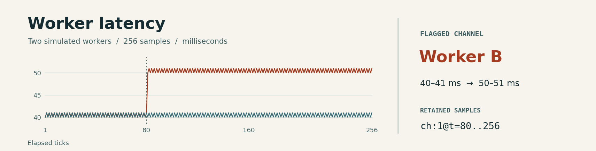
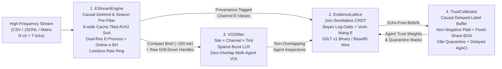

# StreamSieve

**Find which telemetry channels changed, then read the samples behind the alert.**

Put StreamSieve between a metrics collector and an alerting service or monitoring agent. Feed it one row of numeric measurements per tick. It returns a ranked brief with flagged channels, estimated change points and handles for reading back exact samples held in memory.

[Try the Python example](#try-it) · [Use the CLI or MCP server](#quickstart) · [Benchmark results](docs/benchmarks.md) · [Agent reference](llms.txt) · [Find a tool by task](PRODUCTS.md)



## Try it

Install the v0.1.0 wheel from GitHub Releases with CPython 3.9–3.13 on Linux x86-64 (glibc 2.17+, AVX2/FMA) or macOS on Apple Silicon (11+).

```sh
python -m pip install --no-index --only-binary=:all: --find-links https://github.com/pgg898200-ship-it/streamsieve/releases/expanded_assets/v0.1.0 streamsieve==0.1.0
```

Run this example in Python. It works with the release wheel and with the current source.

```python
from streamsieve import EStream

# Two workers alternate between 40 and 41 ms. After 80 samples, B gains 10 ms.
rows = [[40 + t % 2, 40 + t % 2 + 10 * (t >= 80)] for t in range(256)]
with EStream(2, warmup=32, ring_capacity=256) as monitor:
    monitor.update_batch(rows)
    brief = monitor.brief(names=["worker_a_ms", "worker_b_ms"])
    for item in brief["top"]:
        if item["rejected_ebh"]:
            print(item["name"], item["handle"], monitor.fetch_raw(item["handle"])[-1])
```

```text
worker_b_ms ch:1@t=80..256 (256, 51.0)
```

Only worker B crosses the alert threshold. Its last retained sample is 51 ms at tick 256. Keep the monitor alive to resolve its handles. The ring retains the most recent `ring_capacity` samples per channel.

For continuous monitoring, keep an `EStream` per group of channels and update it as new rows arrive. A CLI call analyzes one input window. The stdio MCP server lets an agent call `sift_stream`, then `fetch_raw_ticks` against the same session. Current source adds JSONL input, seasonal adjustment, detrending and a scikit-learn adapter. [Build the current source](#build-the-current-source) · [Statistical assumptions and limits](#honest-limitations-where-not-to-use-streamsieve)

## Catch up a slow reader

[Afterkey](https://github.com/pgg898200-ship-it/streamsieve/tree/main/afterkey) is the standalone C++17 change feed for dashboards and agents that poll at different rates. It returns the latest value or deletion for each changed key since a reader’s cursor. Try the [interactive demo](https://afterkey.tancurl3.chatgpt.site/) or compile the [StreamSieve channel-score example](https://github.com/pgg898200-ship-it/streamsieve/blob/main/afterkey/examples/streamsieve.cpp).

## Route moving agents by zone

[EdgeChime](https://github.com/pgg898200-ship-it/streamsieve/tree/main/edgechime) emits the rectangular zones that each moving agent entered or left. It includes a dependency-free JavaScript API, an NDJSON CLI, and examples for Eclipse SUMO and Tiled. Compare it with a packed R-tree and a perimeter grid on two CPUs, including random jumps where the R-tree wins. [Live demo](https://huggingface.co/spaces/pgg-engineering/edgechime) · [Labeled replay](https://huggingface.co/datasets/pgg-engineering/edgechime-bench) · [Benchmark data](https://github.com/pgg898200-ship-it/streamsieve/blob/main/edgechime/bench/README.md).

## Verified Benchmarks (`StreamSwarmBench`)

Measured live on an Intel Xeon 2.30 GHz Linux VM (2 vCPUs, AVX2+FMA, Python 3.12.16) against `river 0.27.0`, `scipy 1.18.1`, and `numpy 2.5.5`. Full structured output: [`benchmarks/results.json`](https://github.com/pgg898200-ship-it/streamsieve/blob/main/benchmarks/results.json) | Detailed report: [`docs/benchmarks.md`](https://github.com/pgg898200-ship-it/streamsieve/blob/main/docs/benchmarks.md).

### 1. Throughput, Incumbent Speedups & Startup Latency

| Workload | `streamsieve 0.2.0` | Incumbent Baseline | Verified Speedup |
|---|---:|---:|---:|
| Native 8-wide AVX2 CLI (`256 ch × 16,000 ticks`) | **255.67 M ch-ticks/s** (`16.02 ms`) | — | Native C++20 SIMD |
| Native 8-wide AVX2 CLI (`1,024 ch × 4,000 ticks`) | **191.20 M ch-ticks/s** (`21.42 ms`) | — | Native C++20 SIMD |
| Native 8-wide AVX2 CLI (`4,096 ch × 2,000 ticks`) | **146.69 M ch-ticks/s** (`55.85 ms`) | — | Native C++20 SIMD |
| Python batch vs `river.drift.ADWIN` (`64×2k`) | **1.21 ms** (`105.75 M/s`) | `32.62 ms` (`3.92 M/s`) | **26.9× faster** |
| Python batch vs `river.drift.PageHinkley` (`64×2k`) | **1.21 ms** (`105.75 M/s`) | `111.67 ms` (`1.15 M/s`) | **92.3× faster** |
| Python batch + online e-BH vs NumPy/SciPy z+BH (`256×4k`) | **7.58 ms** (`135.18 M/s`) | `79.92 ms` (`12.81 M/s`) | **10.55× faster** |
| Cold startup (CLI vs `import streamsieve`) | **3.87 ms** (CLI) / **25.30 ms** (`import`) | `1,791.01 ms` (`numpy+scipy+river`) | **70.8× faster** (`import`) / **463×** (CLI) |

### 2. Continuous-Peeking Calibration, Zero-Mean Bursts & Non-Stationary Streams

| Benchmark (nominal $\alpha = 0.05$) | `streamsieve 0.2.0` | Naive `\|z\| > 3` | Peeking Welch+BH | `river.ADWIN(0.002)` | `river.PageHinkley` |
|---|---:|---:|---:|---:|---:|
| **Stationary Null FAR** (Gaussian / Student-$t(3)$ / LogNormal / $10^{10}$ DC+1000×) | **0.004 – 0.010** | 0.196 – 0.834 | 0.476 – 0.542 | 0.000 – 0.004 | 0.108 – 1.000 |
| **Non-Stationary Null FAR** (`Diurnal P=24` / `LinearTrend` / `RandomWalk` / `Both`) | **0.010 – 0.050** (`--season` / `--detrend`) | 0.000 – 0.645 | 0.835 – 1.000 | 0.000 – 1.000 | 1.000 |
| **256-Ch Mixed Firehose** (4 shifts + 4 bursts + 32 loud 5×): **Emp. FDR / F1** | **0.000 / 0.883** (`2.8 ms`); peeking **0.040 / 0.909** (`40.8 ms`) | 0.966 / 0.059 | 0.321 / 0.799 (`183.0 ms`) | 0.054 / 0.862 (`49.3 ms`) | — |
| **Zero-Mean `±3.5σ` Bursts** (256-ch): **Burst Recall / F1** | **0.65–0.70 / 0.897–0.900** | 0.30 / 0.102 | **0.00** / 0.578 | **0.00** / 0.667 | — |
| **64-Ch Diurnal (`P=24`, `6σ` wave) Firehose**: **Emp. FDR / F1 / Wall** | **0.000 / 0.799 / 1.7 ms** | — | 0.000 / 0.667 / `125.5 ms` | 0.000 / 0.618 / `11.6 ms` | — |
| **Sequential Stopping** ($H_0$ FAR / $H_1$ Power / Samples Saved) | **0.015 / 1.00 / 70.0%** | — | 0.440 / 1.00 / 74.7% | — | — |

### 3. Multi-Agent Coordination, Token Compression & Real NOAA Weather

| Mechanism | `streamsieve` Engine | Verified Result vs Baseline |
|---|---|---|
| **Token Compression** (`1024 ch × 2000 ticks`, 15.4 MB CSV) | `EStream` | **3,844,353 → 325 tokens (99.99% / 11,829× reduction)** in `53.4 ms`, 1.00/1.00 Prec/Rec, 0 loud FPs, **`0.0` exact raw drill-down error** |
| **Anti-Echo Gossip** ($W = 8$ agents, 40 msgs/trial, 200 trials) | `EvidenceLattice` | **0.0% overwrite churn, 1.00× inflation** (Brier skill `+0.686`) vs 96.5% LWW churn / **10.39×** naive log-odds inflation |
| **Wire Budget** (256 unique findings across 8 hypotheses) | `EvidenceLattice` (`SSLT` v1) | **10,428 B binary** (`13,035` Base85 chars) vs `111,143 B` JSON debate (**10.7× smaller**) |
| **Firehose Attention** (2,048 ch, 256 sites, $W = 4$, 10 seeds) | `VOISifter` | **+0.702 Brier skill, 78.3% Recall@Top, 0.11% inter-agent overlap** vs `-0.010` round-robin / `-32.42` raw-mean |
| **Byzantine + Trust Flip** (4-epoch delay, flip @ 60, 20 seeds) | `TrustCalibrator` | **100.0% Byzantine quarantine**, post-flip Brier **0.1840** vs `0.2179` ExpWeights / `0.2539` mean vote |
| **Real NOAA Seattle `temp_max`** (1,461 days, 4:1 cost, 1-day delay) | `TrustCalibrator` | **30.39% asymmetric cost reduction** (`3.889` vs `5.587`) and **90.01%** empirical coverage on 90% AgACI intervals |

---

## Quickstart

### Build the current source

The examples below use the v0.2.0 code on `main`. Install the Python SDK and its `streamsieve` command with Python 3.9+ and a C++20 compiler.

```sh
git clone https://github.com/pgg898200-ship-it/streamsieve.git
cd streamsieve
python -m pip install .
streamsieve version
```

On Unix, set `CXX=c++` if Python selects a compiler that is missing. For an x86-64 CPU without AVX2/FMA, set `STREAMSIEVE_NO_AVX2=1` before building. To build the separate native executable in the checkout, run `make all` and then `./build/streamsieve version`.

### Read CSV, TSV or JSON Lines from the terminal

```bash
# Each line is a flat JSON object with numeric metric fields
tail -n 2000 metrics.jsonl | streamsieve sift --season 24 --alpha 0.05 --json -

# Detrend linear ramps or random walks (1.0 = causal first difference)
cat cpu_trend.csv | streamsieve sift --detrend 1.0 --alpha 0.05 -

# Compact agent-ready brief on real NOAA telemetry (numeric columns 3-6)
cut -d, -f3-6 examples/noaa_weather.csv | streamsieve sift -

# Native AVX2 throughput self-benchmark & causality self-verification
streamsieve bench --channels 1024 --ticks 4000
streamsieve verify --json
```

### Python SDK and adapters

```python
import streamsieve as ss

# 1. Anytime-valid firehose sift (with optional causal deseasonalizing/detrending) + lossless drill-down
est, brief = ss.sift_matrix(
    matrix, names=col_names, alpha=0.05, season_period=24, detrend_alpha=0.0, ring_capacity=256
)
print(brief.to_compact_text())                        # ~320 tokens regardless of channel count
raw_ticks = est.fetch_raw(brief["top"][0]["handle"])  # bit-exact raw (tick, float) tuples

# 2. Drop-in 1-line replacement for river.drift.ADWIN / PageHinkley (zero river dep!)
from streamsieve import EStreamDrift as ADWIN
det = ADWIN(alpha=0.05, season_period=24)             # catches shifts + zero-mean +-3.5 sigma bursts
for x in stream:
    if det.update(x).drift_detected:
        print(f"Drift ({det.mode}) e={det.e_value:.1f}")

# 3. Drop-in zero-dependency scikit-learn OutlierMixin-compatible multivariate streaming detector
det_sk = ss.SklearnSieveDetector(alpha=0.05, warmup=32, season_period=24)
labels = det_sk.fit_predict(X_stream)                 # +1 calm, -1 anytime-valid e-BH anomaly
print(det_sk.rejected_channels_, det_sk.brief().to_compact_text())

# 4. Zero-echo CRDT multi-agent belief & Vovk-Wang e-value fusion
lat_a, lat_b = ss.EvidenceLattice(), ss.EvidenceLattice()
lat_a.observe("outage", "ch:3@t=180..600", llr=2.4, log_e=3.2, agent_id=0, timestamp_ns=100)
lat_b.observe("outage", "ch:3@t=180..600", llr=2.4, log_e=3.2, agent_id=1, timestamp_ns=200)  # echo!
lat_a.merge(lat_b)                                    # commutative, associative, idempotent
print(lat_a.query("outage"))                          # unique_evidence=1, echoes_suppressed=1

# 5. Zero-overlap hierarchical VOI attention + delayed-label Byzantine-safe TrustCalibrator
sifter = ss.VOISifter(n_channels=2048, n_sites=256, ticks_per_epoch=8)
sifter.set_noise_scales(channel_stds)                 # loud-channel immune
plan = sifter.allocate(budget_per_agent=4, n_agents=4)

tc = ss.TrustCalibrator(n_agents=4, conformal_alpha=0.10)
dec = tc.predict_scalar("day_42", [18.1, 17.8, 18.4, 999.0], underage_cost=4.0, overage_cost=1.0)
tc.resolve("day_42", outcome=18.2)                    # strictly causal delayed resolution
```

See runnable cookbooks in [`examples/jsonl_diurnal_sre.py`](https://github.com/pgg898200-ship-it/streamsieve/blob/main/examples/jsonl_diurnal_sre.py) and [`examples/multi_agent_pipeline.py`](https://github.com/pgg898200-ship-it/streamsieve/blob/main/examples/multi_agent_pipeline.py).

### MCP server and agent configuration

Run the zero-dependency JSON-RPC 2.0 stdio MCP server exposing **7 stateful tools** (`sift_stream` with `jsonl_text` / `csv_text` / `rows` / `json_data`, `fetch_raw_ticks`, `lattice_observe`, `lattice_merge`, `lattice_query`, `voi_allocate`, `trust_step`):

```bash
streamsieve mcp
# or: python3 -m streamsieve.mcp_server
```

Add to `.mcp.json` / Claude Desktop / Cursor MCP config:

```json
{
  "mcpServers": {
    "streamsieve": {
      "command": "streamsieve",
      "args": ["mcp"]
    }
  }
}
```

Plugin manifests and agent skill instructions are pre-packaged at [`SKILL.md`](https://github.com/pgg898200-ship-it/streamsieve/blob/main/SKILL.md), [`.claude-plugin/plugin.json`](https://github.com/pgg898200-ship-it/streamsieve/blob/main/.claude-plugin/plugin.json), and [`.cursor-plugin/plugin.json`](https://github.com/pgg898200-ship-it/streamsieve/blob/main/.cursor-plugin/plugin.json).

---

## Score revised scalar forecasts

[RecastCRPS](https://github.com/pgg898200-ship-it/streamsieve/tree/main/integrations/recastcrps) scores an ensemble after a member revises or withdraws its point forecast. It also identifies the best and worst single-member withdrawals for an equal-weight panel in logarithmic time. A [worked example](https://github.com/pgg898200-ship-it/streamsieve/tree/main/integrations/recastcrps/examples) uses the same forecasts with `TrustCalibrator` and RecastCRPS and resolves both against an observed outcome. [Try the Hurricane Lee replay](https://huggingface.co/spaces/pgg-engineering/recastcrps).

## Architecture: Four Co-Designed Strictly Causal Engines



Every engine obeys **bit-exact zero-lookahead causality** verified by [`assert_causal()`](https://github.com/pgg898200-ship-it/streamsieve/blob/main/python/streamsieve/causality.py) (poisoning all future ticks $s > t$ with `+1e12`, `-1e12`, `NaN`, and `+Inf` produces `0.0` bit diff on outputs at $\le t$).

---

## Verification, Adversarial Testing & Honest Scope

- **Multi-Compiler + Sanitizer Verification:** `make all test-cpp test-san` builds GCC `-O3 -march=native -ffp-contract=off -Wall -Wextra -Wpedantic` (AVX2), strict `clang++ -Werror`, MSVC C++20 on Windows CI, and `-fsanitize=address,undefined,float-cast-overflow` (scalar) with **0 compiler warnings**, **0 sanitizer errors**, and **0-ULP bit-exact parity** across 8-wide/4-wide/scalar AVX2 `update_batch`, `update_row`, and `update_one`.
- **79/79 Zero-Dependency Python Tests + Adversarial Breaker Suite:** Runs unit tests, drop-in `river`/`sklearn` adapter tests, 27 adversarial torture tests ([`tests/test_breaker_adversarial.py`](https://github.com/pgg898200-ship-it/streamsieve/blob/main/tests/test_breaker_adversarial.py)), and 23 v0.2.0 parity/causality/breaker-regression tests ([`tests/test_v020_features.py`](https://github.com/pgg898200-ship-it/streamsieve/blob/main/tests/test_v020_features.py)) covering alternating `±1e308` warmup inputs, seasonal subtraction overflow, simultaneous `1e15` warmup spikes, strict RFC-8259 JSONL fuzzing, deeply nested JSON/bigint inputs, atomic MCP session swaps, and batch-size invariance.
- **Reproduce all benchmarks:**
  ```bash
  PYTHONPATH=python .bench-venv/bin/python benchmarks/run_all.py
  ```

### Honest Limitations (Where NOT to Use `streamsieve`)
- **Detrender choice (`detrend_alpha=1.0` vs `< 1.0`):** Use `detrend_alpha=1.0` (causal first difference) for arbitrarily steep linear trends and random walks (0-tick transient; detects slope breaks & bursts cleanly). Values `0 < detrend_alpha < 1` run a robust 5-sample-median-initialized EWMA high-pass filter suitable for slow drift (converging in `~3/alpha` ticks), not steep ramps.
- **Seasonal period & warmup budget:** Causal deseasonalization (`season_period=P`) freezes per-phase medians over at least `3 * P` warmup ticks (`eff_warmup = max(warmup, 3*P)`) and applies an analytical OOS variance scale correction; streams with time-varying periods or non-integer periods should be residualized externally before feeding `EStream`.
- **Short baselines on ultra-wide panels for rare bursts:** Online e-BH at $M = 1{,}000$ with 1 active channel requires $E \ge 20{,}000$; rare bursts ($p_b \le 0.05$) need enough pre-onset baseline ticks ($n_0$) for the universal-inference Beta-Binomial denominator to separate the rate, or hierarchical triage via `VOISifter`.
- **Single-tick Python loops:** Calling `EStream.update_row()` one row at a time from Python incurs `ctypes` per-call overhead (`4.97 M ch-ticks/s`, still `1.27×` faster than `river.ADWIN`). Batch rows with `update_batch()` (`70–135 M/s`) or use the native CLI/C ABI (`147–256 M/s`).
- **Sybil provenance forgery:** `EvidenceLattice` prevents accidental or gossip-induced double counting when identical observations carry identical content-hashed `provenance_id`s; deliberate Sybil adversaries forging fresh IDs are mitigated by `TrustCalibrator` Ville quarantine.

---

## Documentation & Comparisons


- **Technical Specification & Math:** [`docs/architecture.md`](https://github.com/pgg898200-ship-it/streamsieve/blob/main/docs/architecture.md)
- **Full Benchmark Report (`StreamSwarmBench`):** [`docs/benchmarks.md`](https://github.com/pgg898200-ship-it/streamsieve/blob/main/docs/benchmarks.md) | [`benchmarks/results.json`](https://github.com/pgg898200-ship-it/streamsieve/blob/main/benchmarks/results.json)
- **Runnable Cookbooks:** [`examples/README.md`](https://github.com/pgg898200-ship-it/streamsieve/blob/main/examples/README.md)
- **Honest Head-to-Head Comparisons:**
  - [`streamsieve` vs `river` (ADWIN / Page-Hinkley)](https://github.com/pgg898200-ship-it/streamsieve/blob/main/docs/comparisons/vs-river.md)
  - [`streamsieve` vs Rolling Z-Scores, Welch t-Tests & CUSUM](https://github.com/pgg898200-ship-it/streamsieve/blob/main/docs/comparisons/vs-zscore-and-cusum.md)
  - [`streamsieve` vs Multi-Agent Debate & LWW Blackboards](https://github.com/pgg898200-ship-it/streamsieve/blob/main/docs/comparisons/vs-multiagent-debate.md)
  - [`streamsieve` Online e-BH vs BH / BY / Bonferroni](https://github.com/pgg898200-ship-it/streamsieve/blob/main/docs/comparisons/vs-online-fdr.md)
- **Agent / LLM Machine Index:** [`llms.txt`](https://github.com/pgg898200-ship-it/streamsieve/blob/main/llms.txt) | [`llms-full.txt`](https://github.com/pgg898200-ship-it/streamsieve/blob/main/llms-full.txt) | [`SKILL.md`](https://github.com/pgg898200-ship-it/streamsieve/blob/main/SKILL.md)

## License

Apache License 2.0 — see [`LICENSE`](https://github.com/pgg898200-ship-it/streamsieve/blob/main/LICENSE).
