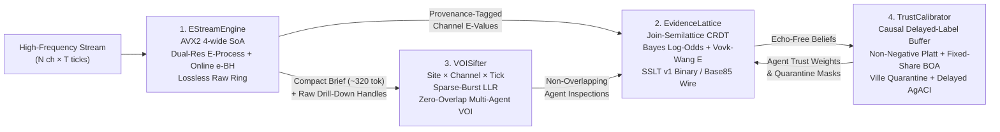

# `streamsieve`

**SIMD C++20/AVX2 anytime-valid streaming inference, zero-echo CRDT belief fusion, and Byzantine-safe multi-agent calibration — zero runtime dependencies, `<5 ms` native CLI, 7-tool MCP server, and 99.99% LLM token compression with bit-exact raw drill-down.**

[](pyproject.toml)
[](csrc/streamsieve_core.hpp)
[](tests/)
[](LICENSE)

AI agent fleets break in four predictable ways on live data streams:

1. **Context-window blowup** — dumping 1,024-channel telemetry into prompts burns millions of tokens and gets trapped by high-variance "loud channels."
2. **Continuous-peeking p-hacking** — polling rolling z-scores or Welch $t$-tests every few ticks inflates false alarms from 5% to **20–83%** under heavy tails or DC offsets.
3. **Echo-chamber double-counting** — gossiping findings across $W$ agents multiplies log-odds by **5–10×** or causes **93–97%** last-write-wins overwrite churn.
4. **Delayed-label & Byzantine trust collapse** — uncalibrated "bloviators", poisoned agents, and sudden regime flips wreck naive voting when ground truth arrives late and out of order.

`streamsieve` solves all four in a single **zero-dependency C++20/AVX2 engine** exposed via a `<5 ms` native CLI, a zero-dependency Python SDK (`ctypes` + zero-copy `memoryview`/NumPy support), a 7-tool JSON-RPC 2.0 stdio **MCP server**, and drop-in **Claude Code / Cursor plugin skills**.

---

## Verified Benchmarks (`StreamSwarmBench`)

Measured live on an Intel Xeon 2.30 GHz Linux VM (2 vCPUs, AVX2+FMA, Python 3.12.16) against `river 0.27.0`, `scipy 1.18.1`, and `numpy 2.5.5`. Full structured output: [`benchmarks/results.json`](benchmarks/results.json) | Detailed report: [`docs/benchmarks.md`](docs/benchmarks.md).

### 1. Throughput, Incumbent Speedups & Startup Latency

| Workload | `streamsieve 0.1.0` | Incumbent Baseline | Verified Speedup |
|---|---:|---:|---:|
| Native AVX2 CLI (`256 ch × 16,000 ticks`) | **160.75 M ch-ticks/s** (`25.48 ms`) | — | Native C++20 SIMD |
| Native AVX2 CLI (`4,096 ch × 2,000 ticks`) | **93.15 M ch-ticks/s** (`87.94 ms`) | — | Native C++20 SIMD |
| Python batch vs `river.drift.ADWIN` (`64×2k`) | **1.95 ms** (`65.77 M/s`) | `33.18 ms` (`3.86 M/s`) | **17.1× faster** |
| Python batch vs `river.drift.PageHinkley` (`64×2k`) | **1.95 ms** (`65.77 M/s`) | `105.92 ms` (`1.21 M/s`) | **54.4× faster** |
| Python batch + online e-BH vs NumPy/SciPy z+BH (`256×4k`) | **13.70 ms** (`74.77 M/s`) | `77.36 ms` (`13.24 M/s`) | **5.65× faster** |
| Cold startup (`./build/streamsieve version` vs `import`) | **4.03 ms** (CLI) / **24.90 ms** (`import streamsieve`) | `1,691.69 ms` (`numpy+scipy+river`) | **68× faster** (`import`) / **420×** (CLI) |

### 2. Continuous-Peeking Calibration & Rare Zero-Mean Burst Detection

| Benchmark (nominal $\alpha = 0.05$) | `streamsieve` | Naive `\|z\| > 3` | Peeking Welch+BH | `river.ADWIN(0.002)` | `river.PageHinkley` |
|---|---:|---:|---:|---:|---:|
| **Null Peeking FAR** (Gaussian / Student-$t(3)$ / LogNormal / $10^{10}$ DC+1000×) | **0.004 – 0.010** | 0.196 – 0.834 | 0.476 – 0.542 | 0.000 – 0.004 | 0.108 – 1.000 |
| **256-Ch Firehose** (4 shifts + 4 bursts + 32 loud 5×): **Emp. FDR / F1** | **0.000 / 0.883** (`3.8 ms`) | 0.966 / 0.060 | 0.321 / 0.800 (`183.9 ms`) | 0.054 / 0.862 (`47.4 ms`) | — |
| **Zero-Mean `±3.5σ` Bursts** (256-ch): **Burst Recall / F1** | **0.65–0.70 / 0.900** | 0.30 / 0.102 | **0.00** / 0.578 | **0.00** / 0.667 | — |
| **Sequential Stopping** ($H_0$ FAR / $H_1$ Power / Samples Saved) | **0.015 / 1.00 / 70.0%** | — | 0.440 / 1.00 / 74.7% | — | — |

### 3. Multi-Agent Coordination, Token Compression & Real NOAA Weather

| Mechanism | `streamsieve` Engine | Verified Result vs Baseline |
|---|---|---|
| **Token Compression** (`1024 ch × 2000 ticks`, 15.4 MB CSV) | `EStream` | **3,844,353 → 325 tokens (99.99% / 11,829× reduction)**, 1.00/1.00 Prec/Rec, 0 loud FPs, **`0.0` exact raw drill-down error** |
| **Anti-Echo Gossip** ($W = 8$ agents, 40 msgs/trial, 200 trials) | `EvidenceLattice` | **0.0% overwrite churn, 1.00× inflation** (Brier skill `+0.686`) vs 96.5% LWW churn / **10.39×** naive log-odds inflation |
| **Wire Budget** (256 unique findings across 8 hypotheses) | `EvidenceLattice` (`SSLT` v1) | **10,428 B binary** (`13,035` Base85 chars) vs `111,143 B` JSON debate (**10.7× smaller**) |
| **Firehose Attention** (2,048 ch, 256 sites, $W = 4$, 10 seeds) | `VOISifter` | **+0.702 Brier skill, 78.3% Recall@Top, 0.11% inter-agent overlap** vs `-0.010` round-robin / `-32.42` raw-mean |
| **Byzantine + Trust Flip** (4-epoch delay, flip @ 60, 20 seeds) | `TrustCalibrator` | **100.0% Byzantine quarantine**, post-flip Brier **0.1840** vs `0.2179` ExpWeights / `0.2539` mean vote |
| **Real NOAA Seattle `temp_max`** (1,461 days, 4:1 cost, 1-day delay) | `TrustCalibrator` | **30.39% asymmetric cost reduction** (`3.889` vs `5.587`) and **90.01%** empirical coverage on 90% AgACI intervals |

---

## Quickstart (3 Commands)

### 1. Build Native AVX2 Core & CLI

```bash
git clone https://github.com/pgg898200-ship-it/streamsieve.git && cd streamsieve
make all test-cpp
```

### 2. Sift Any CSV/TSV Stream from the Terminal (`<5 ms` cold start)

```bash
# Compact agent-ready brief with lossless drill-down handles (numeric columns 3-6)
cut -d, -f3-6 examples/noaa_weather.csv | ./build/streamsieve sift -

# Machine-readable RFC-8259 JSON brief from stdin
cat metrics.csv | ./build/streamsieve sift --alpha 0.05 --top 10 --json -

# Native AVX2 throughput self-benchmark
./build/streamsieve bench --channels 1024 --ticks 4000
```

### 3. Zero-Dependency Python SDK

```bash
pip install --no-build-isolation -e .   # or: PYTHONPATH=python python3 ...
```

```python
import streamsieve as ss

# 1. Anytime-valid firehose sift + bit-exact lossless drill-down
est, brief = ss.sift_matrix(matrix, names=col_names, alpha=0.05, ring_capacity=256)
print(brief.to_compact_text())                    # ~320 tokens regardless of channel count
raw_ticks = est.fetch_raw(brief["top"][0]["handle"])  # exact (tick, float) tuples

# 2. Zero-echo CRDT multi-agent belief & Vovk-Wang e-value fusion
lat_a, lat_b = ss.EvidenceLattice(), ss.EvidenceLattice()
lat_a.observe("outage", "ch:3@t=180..600", llr=2.4, log_e=3.2, agent_id=0, timestamp_ns=100)
lat_b.observe("outage", "ch:3@t=180..600", llr=2.4, log_e=3.2, agent_id=1, timestamp_ns=200)  # echo!
lat_a.merge(lat_b)                                # commutative, associative, idempotent
print(lat_a.query("outage"))                      # unique_evidence=1, echoes_suppressed=1

# 3. Zero-overlap hierarchical VOI multi-agent read allocation
sifter = ss.VOISifter(n_channels=2048, n_sites=256, ticks_per_epoch=8)
sifter.set_noise_scales(channel_stds)             # loud-channel immune
plan = sifter.allocate(budget_per_agent=4, n_agents=4)

# 4. Delayed-label Platt calibration, Ville quarantine & asymmetric-cost AgACI action
tc = ss.TrustCalibrator(n_agents=4, conformal_alpha=0.10)
dec = tc.predict_scalar("day_42", [18.1, 17.8, 18.4, 999.0], underage_cost=4.0, overage_cost=1.0)
tc.resolve("day_42", outcome=18.2)                # strictly causal delayed resolution

# 5. Drop-in 1-line replacement for river.drift.ADWIN / PageHinkley (zero river dep!)
from streamsieve import EStreamDrift as ADWIN
det = ADWIN(alpha=0.05)                           # catches shifts + zero-mean +-3.5 sigma bursts
for x in stream:
    if det.update(x).drift_detected:
        print(f"Drift ({det.mode}) e={det.e_value:.1f}")
```

### 4. Drop-In MCP Server & Claude Code / Cursor Skill

Run the zero-dependency JSON-RPC 2.0 stdio MCP server exposing **7 stateful tools** (`sift_stream`, `fetch_raw_ticks`, `lattice_observe`, `lattice_merge`, `lattice_query`, `voi_allocate`, `trust_step`):

```bash
PYTHONPATH=python python3 -m streamsieve.mcp_server
```

Add to `.mcp.json` / Claude Desktop / Cursor MCP config:

```json
{
  "mcpServers": {
    "streamsieve": {
      "command": "python3",
      "args": ["-m", "streamsieve.mcp_server"],
      "env": { "PYTHONPATH": "/path/to/streamsieve/python" }
    }
  }
}
```

Plugin manifests and agent skill instructions are pre-packaged at [`SKILL.md`](SKILL.md), [`.claude-plugin/plugin.json`](.claude-plugin/plugin.json), and [`.cursor-plugin/plugin.json`](.cursor-plugin/plugin.json).

---

## Architecture: Four Co-Designed Strictly Causal Engines



Every engine obeys **bit-exact zero-lookahead causality** verified by [`assert_causal()`](python/streamsieve/causality.py) (poisoning all future ticks $s > t$ with `+1e12`, `-1e12`, `NaN`, and `+Inf` produces `0.0` bit diff on outputs at $\le t$).

---

## Verification, Adversarial Testing & Honest Scope

- **C++20 Core + Sanitizers:** `make all test-cpp test-san` builds `-O3 -march=native -ffp-contract=off -Wall -Wextra -Wpedantic` (AVX2) and `-fsanitize=address,undefined` (scalar) with **0 compiler warnings**, **0 sanitizer errors**, and **bit-exact AVX2-vs-scalar parity**.
- **56/56 Zero-Dependency Python Tests + Adversarial Breaker Suite:** `PYTHONPATH=python python3 -m unittest discover -s tests -p "test_*.py" -v` runs 29 unit/adapter tests + 27 independent adversarial torture tests ([`tests/test_breaker_adversarial.py`](tests/test_breaker_adversarial.py)) covering non-SIMD channel widths (`1, 3, 5, 7, 13, 17`), `±1e300` spikes on constant-zero channels, `1e17` tick-0 warmup spikes, 6 heavy-tailed/skewed/bimodal/loud continuous-peeking distributions, 600 randomized CRDT axiom trials, 500× echo storms, 40% Byzantine poisoning + trust flips, strict zero-lookahead causality across all 4 engines, drop-in `EStreamDrift` parity, and MCP/CLI JSON security fuzzing.
- **Reproduce all benchmarks:**
  ```bash
  PYTHONPATH=python .bench-venv/bin/python benchmarks/run_all.py
  ```

### Honest Limitations (Where NOT to Use `streamsieve`)
- **Non-stationary raw series (strong trends / diurnal seasonality):** `EStream` guarantees anytime-valid null calibration under stationary/exchangeable nulls (including heavy tails, skew, and huge DC offsets). Feed one-step prediction residuals or deseasonalized differences for trending/seasonal metrics.
- **Short baselines on ultra-wide panels for rare bursts:** Online e-BH at $M = 1{,}000$ with 1 active channel requires $E \ge 20{,}000$; rare bursts ($p_b \le 0.05$) need enough pre-onset baseline ticks ($n_0$) for the universal-inference Beta-Binomial denominator to separate the rate, or hierarchical triage via `VOISifter`.
- **Single-tick Python loops:** Calling `EStream.update_row()` one row at a time from Python incurs `ctypes` per-call overhead (`5.67 M ch-ticks/s`, still `1.47×` faster than `river.ADWIN`). Batch rows with `update_batch()` (`65–87 M/s`) or use the native CLI/C ABI (`93–161 M/s`).
- **Sybil provenance forgery:** `EvidenceLattice` prevents accidental or gossip-induced double counting when identical observations carry identical content-hashed `provenance_id`s; deliberate Sybil adversaries forging fresh IDs are mitigated by `TrustCalibrator` Ville quarantine.

---

## Documentation & Comparisons

- **Technical Specification & Math:** [`docs/architecture.md`](docs/architecture.md)
- **Full Benchmark Report (`StreamSwarmBench`):** [`docs/benchmarks.md`](docs/benchmarks.md) | [`benchmarks/results.json`](benchmarks/results.json)
- **Honest Head-to-Head Comparisons:**
  - [`streamsieve` vs `river` (ADWIN / Page-Hinkley)](docs/comparisons/vs-river.md)
  - [`streamsieve` vs Rolling Z-Scores, Welch t-Tests & CUSUM](docs/comparisons/vs-zscore-and-cusum.md)
  - [`streamsieve` vs Multi-Agent Debate & LWW Blackboards](docs/comparisons/vs-multiagent-debate.md)
  - [`streamsieve` Online e-BH vs BH / BY / Bonferroni](docs/comparisons/vs-online-fdr.md)
- **Agent / LLM Machine Index:** [`llms.txt`](llms.txt) | [`llms-full.txt`](llms-full.txt) | [`SKILL.md`](SKILL.md)

## License

Apache License 2.0 — see [`LICENSE`](LICENSE).
