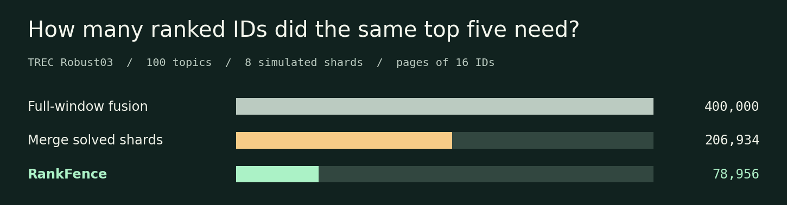

# RankFence

## Preview delayed shard startup in Python 0.2.0a1

[Download the prerelease wheel and its checksum](releases/deferred-0.2.0a1). With this wheel, a query can wait for the first catalog pages before opening the archive:

```python
result = await fuse_partitioned(
    [catalog_title, catalog_body, archive_body],
    ["catalog", "catalog", "archive"], k=1, defer_groups=("archive",),
)
```

On SciFact this avoided all 300 archive opens with two catalog rankers and one archive ranker. Giving both shards two rankers improved cited-paper hits and eliminated the startup savings. [Read the paired measurements and reproduce both layouts](results/scifact-defer-v1.md).


**Stop fetching search results when the next page can’t change the winners.** RankFence merges paged rankings with reciprocal rank fusion (RRF). Put it between your keyword and vector retrievers and the component that consumes their top results, such as a reranker or a RAG context builder. It returns the exact ordered document IDs and closes cursors it no longer needs.

[Try a query in your browser](https://rankfence-pgg.tancurl3.chatgpt.site/workbench.html) · [Connect live cursors](#use-live-retrieval-cursors) · [Call from an MCP client](#let-an-agent-measure-its-own-workload)

## Try one query

Install the Python 3.10+ wheel. It has no runtime dependencies.

```sh
python -m pip install https://raw.githubusercontent.com/pgg898200-ship-it/streamsieve/9107326cf0993e842c281d412cb276e83eb1c6a4/releases/rankfence-0.1.0-py3-none-any.whl
```

Two search shards each run a keyword and a vector retriever. Both western retrievers rank the same document first. Each eastern retriever ranks a different document first.

```python
from rankfence import PartitionFence

fence = PartitionFence(["west", "west", "east", "east"], k=1)
for source, first_id in enumerate(["west/alpha", "west/alpha", "east/delta", "east/epsilon"]):
    fence.push(source, [first_id])

print(fence.ordered())  # ('west/alpha',)
print(fence.done)       # (False, False, False, False)
```

All four cursors are still open. No eastern document can take first place because each one already missed at least one rank-one contribution. The source map guarantees that eastern documents can’t also collect points in the west. If any two sources can return the same document, keep those sources in the same group. When ownership is unknown, use `Fence(sources=4, k=1)`.

Use `ordered()` for a ranked result or `members()` for the winning set. Each returns `None` until it can prove the answer. A certified ID can still gain score as more pages arrive.

[](results/README.md)

## Why give the coordinator a shard map?

Consider eight indexes, each with four ranked retrievers. An item in shard A can collect four reciprocal-rank contributions. A coordinator that only knows there are 32 open streams must allow that item to appear in the other 28. Declaring the disjoint ID namespaces tightens the highest score every challenger could still reach. A complete ranking from any individual shard can also require more pages than the global consumer needs.

On 100 TREC Robust03 topics, we hash-partitioned each original ranking into eight shards and recomputed ranks within each shard. All methods solved the same resulting 32-stream queries and produced the same ordered top five. This is a simulation of a sharded service on historical retrieval results. The ranking contract uses the position in each component cursor. Repartitioning can change those positions and the answer. Systems that require invariance under resharding need globally comparable scores or global per-retriever ranks. [Example of a global-rank contract](https://github.com/ai-pipestream/protomolt-search)

| Method | Ranked IDs consumed across 100 topics |
|---|---:|
| Full-window fusion | 400,000 |
| RankSeal on all 32 streams | 400,000 |
| RankSeal in each shard, then merge resolved scores | 206,934 |
| RankFence with the shard map | 82,637 |
| **RankFence with the shard map and individual shard retirement** | **78,956** |
| Independent integer no-random-access algorithm with the same shard map | 82,637 |

With shard retirement enabled, the coordinator read **61.84% fewer IDs** than the local RankSeal merge. All 100 answers matched exhaustive fusion. The lower bound comes from known document ownership. A sufficiently capable competing implementation can use the same information.

The RankFence implementation also supports unpartitioned streams, membership-only proofs and an independent receipt verifier. RankSeal supports weighted inputs and a two-source hindsight benchmark. For mutable rankings with replacements and withdrawals, see the PGG RankPatch project. Stable ranked pages are required here.

## Use live retrieval cursors

```python
from rankfence import Page, fuse_partitioned, verify

async def ranked_pages(cursor):
    try:
        async for ids, is_last in cursor:
            yield Page(ids, done=is_last)
    finally:
        await cursor.aclose()

async def top_documents(cursors, shard_names):
    result = await fuse_partitioned(
        [ranked_pages(cur) for cur in cursors], shard_names, k=5, receipt=True
    )
    assert verify(result.receipt, source_groups=shard_names)
    return result.ids
```

Open one consistent query snapshot per producer. The sources may finish at different times. The adapter owns each iterator, keeps at most one page request per source in flight, propagates source failures, and closes iterators when done. The partitioned adapter retires losing shard cursors as soon as their strongest possible candidate falls below the current global cutoff. Retired cursors keep their true EOF flags. Pass `prune=False` to disable the extra checks. Remote work stops only if the provider supports cancellation or lazy production. For flat rankings, `await fuse(sources, k=5, receipt=True)` uses the same page interface.

The [SQLite FTS5 example](examples/sqlite_fts.py) builds a real full-text index of the installed Python standard library, ranks matches with three BM25 configurations, closes its cursors at certification, and checks the answer against exhaustive RRF. On our Python 3.12 corpus, the default query read 72 of 1,605 result rows. Run `python examples/sqlite_fts.py --shards 4` for four actual FTS5 tables and twelve ranked cursors. The query `file` read 96 of 1,605 rows and returned the same top three as exhaustive shard-local-rank fusion. Across seven illustrative searches, the partitioned coordinator consumed 612 rows against 900 for independently solving each shard and merging its exact scores. These counts measure rows fetched from component retrievers. A backend that natively returns fused, scored shard winners has a different interface. SQLite can score and sort matches before the client reads its first page.

## Let an agent measure its own workload

After installing the wheel, configure a local MCP server using the Python interpreter that contains RankFence. A typical stdio client accepts this entry.

```json
{"mcpServers":{"rankfence":{"command":"python","args":["-m","rankfence.mcp"]}}}
```

Call `rankfence_analyze` with the complete ranked lists for one query. This replays equal-sized pages and checks the winners against exhaustive RRF. The public and local tools accept this input.

```json
{
  "rankings": [
    ["west/alpha", "west/beta", "west/gamma"],
    ["west/alpha", "west/gamma", "west/beta"],
    ["east/delta", "east/epsilon", "east/zeta"],
    ["east/epsilon", "east/zeta", "east/delta"]
  ],
  "source_groups": ["west", "west", "east", "east"],
  "k": 1,
  "page_size": 1
}
```

The result includes `ids: ["west/alpha"]`, `ids_read_in_replay: 4`, `ids_in_full_query: 12`, and `matches_exhaustive: true`. The tool receives all 12 IDs up front. The count of four tells you where live cursors could have stopped on this query. The local server also returns a receipt. Use `rankfence_verify` with the trusted shard map to check it independently.

## Verify a receipt or explain a wait

A receipt contains the actual prefixes, EOF assertions, ranking parameters and returned IDs. The verifier rebuilds exact rational score intervals independently. For a partitioned receipt, compare its source groups to your own trusted index topology. An upstream source must vouch for rank order, EOF and namespace isolation.

The command line reads a stream of newline-delimited JSON pages. This example produces a flat receipt and checks it in a second process.

```sh
printf '%s\n' '{"source":0,"ids":["alpha"]}' '{"source":1,"ids":["alpha"]}' |
  python -m rankfence fuse --sources 2 -k 1 --receipt |
  python -m rankfence verify
```

For a flat stream that has not settled, `counterexample(prefixes, done, k)` can construct two valid completions that change the winners or their order. It returns the hypothetical suffixes and exact answer for each. A missing counterexample is inconclusive.

In a 32-source synthetic asyncio example, the coordinator closed all 29 losing cursors before the deciding page arrived. Median aggregate time that losing cursors stayed open fell from 1,193 to 8.85 cursor-ms across seven alternating runs. Median answer latency stayed near 41 ms. [Run the cancellation example](examples/retirement.py) · [Raw samples](results/retirement.json)

## Input contract

| Field | Requirement |
|---|---|
| Rankings | Immutable, append-only, unique string IDs within each source. IDs can repeat across retrievers in the same shard. |
| Source groups | Every occurrence of a document, present and future, belongs to one group. Use one group when uncertain. Qualifying IDs by shard is correct only for genuinely distinct documents. |
| Scores | Standard unweighted RRF, sum of `1/(c + rank)` for each observed rank. Rank starts at 1, `c` defaults to 60, absent IDs contribute zero. |
| Ties | Ascending Python string order, including exact rational ties. |
| End of stream | A true final page or natural exhaustion. A timeout, dropped packet or partial error does not establish EOF. |
| Output | Ordered tuple or winner set, possibly shorter than k once the available documents are exhausted. |
| Execution | Serialize updates to a single query coordinator. Memory grows with the prefixes retained. Duplicate IDs in a page or the same source are rejected. |

For an unobserved term from an open stream of depth d, the maximum contribution is `1/(c+d+1)`. For a seen document, sum only possible missing terms in its shard. For a document not yet seen anywhere, take the largest possible score across shards. Compare these upper bounds against the known scores of the winners. The implementation groups candidates by the sources that have reported them, uses integer intervals for fast separation and resolves close score comparisons using exact rationals. These are applications of established top-k aggregation methods. [Fagin, Lotem and Naor](https://www.cs.ubc.ca/~laks/cpsc504/fagin-jcss03.pdf) · [Mamoulis et al.](https://www.cs.uoi.gr/~nikos/lara_tods.pdf)

## When do fewer pages improve latency?

Measure the price of fetching the next page in your own stack. In our four-producer TCP replay, RankFence reached the median answer in 45.5 ms against 106.4 ms for one-shot retrieval when the producers incurred an imposed 100 μs per returned hit and 1 ms per request. Without added delays one-shot won, and one-shot retained the best p95 in all three tested scenarios. Flat fusion skipped 79.21% of entries across all 100 Robust03 queries and 73.70% on 102 NFCorpus queries. An independent exact streaming algorithm stopped at the same page on every query.

A second test deliberately made the rankers disagree. On three synthetic 32-source queries the unpartitioned coordinator had to read all 65,536 entries and a warm exact integer batch was faster. Use full-window fusion for cheap materialized results when your end-to-end measurements favor it. Growing a top-k ANN request can change earlier IDs; supply a stable cursor or a materialized snapshot.

## Reproduce

From an unpacked source release:

```sh
python -m unittest discover -v
python examples/sqlite_fts.py
python bench.py
python benchmarks/fetch_replay.py robust03 /tmp/robust03.json
python bench.py --trace /tmp/robust03.json --page 32 --repeats 3
python examples/partition_replay.py --help
```

The raw reports record input counts, environment and timings, including the methods that won. There is no hosted ingestion service or API key. Receipts can contain private document IDs; the verifier runs locally. [Full benchmark report](results/README.md)
