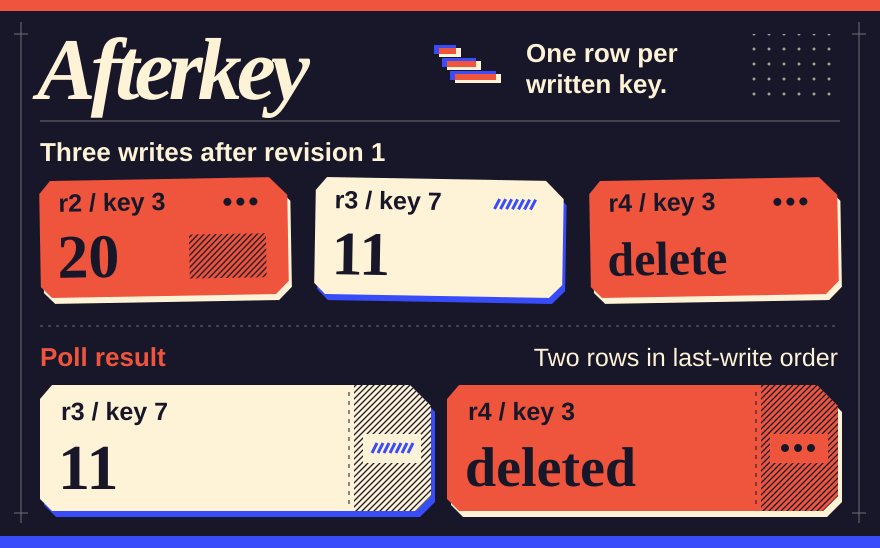

# Afterkey

Afterkey is a header-only C++17 library for dashboards and workers that need the current state of a producer. Each reader saves a revision number. On its next poll, it gets one row per key written since that revision, ordered by the key’s last write. The row holds the latest value or marks a deletion.

If a worker publishes its available slot count ten times between polls, the dashboard receives just the last count.



[Try two readers in your browser](https://huggingface.co/spaces/pgg-engineering/afterkey) · [Download the C++17 kit](https://raw.githubusercontent.com/pgg898200-ship-it/streamsieve/main/afterkey/releases/afterkey-pages-9f74b70c.tar.gz) · [Reproduce the benchmarks](bench/environment.md)

## Run a catch-up in two-row pages

The example tracks available slots per worker. The reader last saw worker 0 with eight slots. While it is away, that count falls to seven, then six. Worker 1 reports twelve slots, and the producer records a deletion for worker 2. Build the example with a C++17 compiler.

```sh
curl -fsSLO https://raw.githubusercontent.com/pgg898200-ship-it/streamsieve/main/afterkey/releases/afterkey-pages-9f74b70c.tar.gz
tar -xzf afterkey-pages-9f74b70c.tar.gz
cd afterkey-pages
c++ -std=c++17 -O2 -Iinclude example.cpp -o afterkey-demo
./afterkey-demo
```

The first two rows make up page one. Worker 1 comes first because it reported before worker 0’s final write. The deletion is the only row on page two.

```text
3 key=1 slots=12
4 key=0 slots=6
5 key=2 deleted
```

Copy [afterkey.hpp](include/afterkey.hpp) or [afterkey_journal.hpp](include/afterkey_journal.hpp) into your include path. Each header works on its own. Each callback receives a revision, a dense key and a borrowed pointer to the current value. A null pointer means deletion. The [full-feed example](examples/quickstart.cpp) uses `since` to read all changes in one call. [Edit the worker updates in Compiler Explorer](https://godbolt.org/z/Tz3sP7KMj) to run the C++17 header and inspect the rows that reach the reader.

A reader whose cursor equals the oldest retained revision can start directly at its successor, even when it has lost its key hint.

The kit includes the tests, comparison harness and raw measurements. Its SHA-256 is `59dc754499c4e1ce1f8aeb67936b28de1d409120faabe6939c3dd86bea981b63`. The [0.1.0 ZIP](https://raw.githubusercontent.com/pgg898200-ship-it/streamsieve/main/afterkey/releases/afterkey-0.1.0.zip) contains the original full-feed API.

## Read a bounded page

Both `Index` and `Journal` expose `since_page(revision, last_key, limit, callback)`. It returns the number of rows delivered and stops at the requested limit. A deletion consumes one row. Use `std::nullopt` when only the revision is available.

```cpp
std::uint64_t cursor = 0;
std::optional<std::uint32_t> last_key;
auto delivered = index.since_page(cursor, last_key, 16,
    [&](std::uint64_t revision, std::uint32_t key, const int* value) {
        apply(key, value);  // copy the value, or apply the tombstone
        cursor = revision;
        last_key = key;
    });
```

Use the last delivered revision and key on the next call. For a durable consumer, commit the cursor and applied page together. A retry after a partial failure can redeliver rows, so apply values and deletions idempotently. Each call reads current state, so writes between pages can supersede unseen rows. Empty pages leave the caller's cursor unchanged. A zero limit delivers no rows and a future revision still throws.

A matching key hint gives `Index` a direct link to the next row. A stale or invalid hint uses the existing numeric seek, which can walk the full changed suffix. `Journal` computes the start position directly for recent cursors and uses the hint or binary search for packed history. It skips superseded entries, so the page limit bounds delivered rows and callbacks. The number of journal positions scanned can be higher.

### Skip long runs of superseded writes

Use `afterkey::Journal<T, true>` when readers frequently cross a large contiguous run of retired journal positions. One bit records whether each position holds a current key, and a second level records which 64-position words have any live entries. Both `since` and `since_page` can skip holes. The default `Journal<T>` keeps the original sequential scan and write costs.

At 65,536 keys the two bitmaps occupy 16,640 bytes (about 0.254 bytes/key), plus implementation-specific bookkeeping. Writes update the maps and compaction rebuilds them. Dense sequential reads can be faster with the default journal. Both configurations emit identical rows and preserve the same cursor and callback contracts. Recompile consumers when updating these header-only templates.

A seeded 65,536-key replay on one shared AMD EPYC 9V74 VM retired a contiguous quarter of the original registration order. Median time to deliver a 16-row page starting inside that gap was **90 ns** with sparse reads and **6,690 ns** with the default journal. On the 64-row sparse catch-up, whole-feed times were 261 ns and 4,727 ns. For 4,096 densely surviving rows they were 6,780 ns and 6,710 ns. After compaction the writes measured 6.95 ns and 5.74 ns respectively, and the sparse configuration added 16,688 allocated bytes. These synthetic in-process measurements include a consuming callback. The kit includes these measurements under `comparison/bench/afterkey/`. [Benchmark methods, losing cases and Google Borg trace replay](https://pgg-tailstate.tancurl3.chatgpt.site/comparison.html).

## Which workload benefits?

When writes concentrated on 16 of 1,048,576 populated keys, Index took **5.60 ns per operation** and a cursor-indexed append log took **11.45 ns**. When writes spread uniformly across 16,384 keys, the log was faster at **121.63 ns** against **421.46 ns** for Index. Each run used 16 staggered readers on a shared AMD EPYC 9V74 VM. One operation is a write or a poll, and one poll can deliver many rows.

| Synthetic workload | Afterkey Index (ns/op) | Bounded Journal (ns/op) | Cursor log (ns/op) | `std::list` (ns/op) |
| --- | ---: | ---: | ---: | ---: |
| 1M populated keys, 16 hot | 5.60 | 20.47 | 11.45 | 6.42 |
| 16K populated keys, 16 hot | 4.41 | 13.09 | 10.41 | 6.06 |
| 16K populated keys, uniform writes | 421.46 | 134.77 | 121.63 | 546.34 |

The table shows medians across five or nine trials. Timings include the callback and exclude initialization. With uniform writes, Journal’s contiguous traversal was faster than Index in this workload. CPU-time medians, sample ranges, the full-map scan and additional cases are in the [results CSV](bench/results.csv).

With **4,096 independently lagging readers**, a second benchmark measured each synchronous catch-up call on one thread. For a moving hot set, p99 was **1.67 µs** for Index and **4.99 µs** for the cursor log. With uniform writes, p99 was **417.86 µs** and **75.92 µs** respectively. The timer includes the consuming callback. Queueing, network and producer time are excluded. [Latency harness](bench/fanout.cpp) · [Raw percentiles](bench/fanout.json)

The public replays check exact ordered outputs. On the FreeInference session trace an hourly reader received 64 rows for 1,375 recorded completions. On the Paris Vélib’ trace an hourly reader received 895,673 rows for 5,143,865 recorded writes. At one-minute intervals only 94 Paris writes were superseded. Poll schedules were simulated. These counts describe the work a reader can skip. [Sources, checksums and replay commands](bench/replay.md)

## Contracts and costs

| | Index | Journal |
| --- | --- | --- |
| Header | `afterkey.hpp` | `afterkey_journal.hpp` |
| Write | O(1) worst-case bookkeeping | O(1) amortized, O(capacity) on compaction |
| Read | O(1 + distinct keys touched since cursor) | Scans up to min(2 × capacity, writes since cursor) entries, plus a seek for older cursors |
| Storage | Dense slots, two 32-bit neighbor indices per slot | Dense slots plus a bounded chronological key journal |

Both implementations retain one current payload per live key and tombstones for erased keys. Their own storage is allocated at construction. Payloads and callbacks can allocate. Use an application-level dense ID mapping for strings or sparse IDs. Every put and erase advances the revision, including unchanged values and repeated erases. The index rejects future cursors, out-of-range keys and callback writes. Payloads must be nothrow-move-constructible and nothrow-destructible.

Run reads and writes on one event loop or serialize access externally. Cursors belong to one live instance. On process restart generate a new instance identifier, replace client state, and replay from zero. A client expanding its subscription also needs a fresh snapshot of added keys. For audit trails, increments, commands and intermediate transitions, retain a separate event log.

## Integrations

- The [StreamSieve example](examples/streamsieve.cpp) publishes absolute scores and checks that a dashboard and a slower observer both reconstruct the underlying native state.
- [ZeroMQ catch-up](examples/zmq_catchup.cpp) serves independent filtered readers over REQ/REP, including tombstones and reconnects to the same server instance. Its topic masks filter after index traversal. Build instructions are in the example. The multi-topic slow-consumer case was described in [libzmq issue 1688](https://github.com/zeromq/libzmq/issues/1688).
- [Randomized reference tests](tests/test_afterkey.cpp) exercise tombstones, callbacks, independent readers and historical cursors across compactions. Run `c++ -std=c++17 -O2 tests/test_afterkey.cpp -o /tmp/test-afterkey && /tmp/test-afterkey`.

## Prior art

Kubernetes already moves changed nodes to the head of a generation-ordered list and stops its snapshot walk when it reaches an old generation. CouchDB provides a durable document changes feed with latest-change semantics. Chronicle Ring offers conflation for low-latency messaging. Afterkey packages this pattern as a small, in-process C++ component with dense storage, ordered tombstones and reproducible crossover measurements. The measured competitors above are in-process C++ implementations. [Kubernetes scheduler source](https://cos.googlesource.com/third_party/kubernetes/+/4f5c634fcfa498e3634c9b6b31cc4ca4c6a1203c/pkg/scheduler/backend/cache/cache.go) · [CouchDB changes feed](https://docs.couchdb.org/en/stable/api/database/changes.html) · [Chronicle Ring](https://chronicle.software/products/chronicle-ring)

Afterkey source is licensed under [Apache-2.0](LICENSE). Trace datasets retain their respective licenses.
