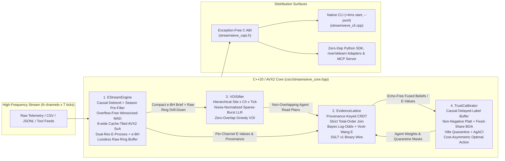
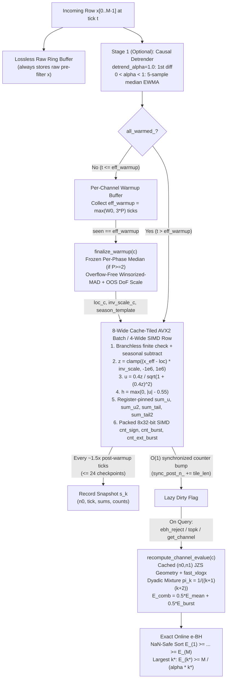
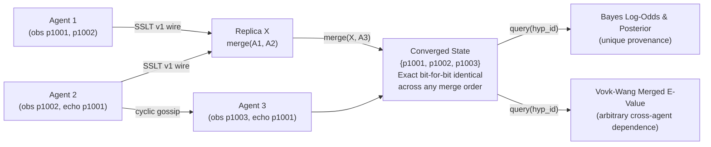
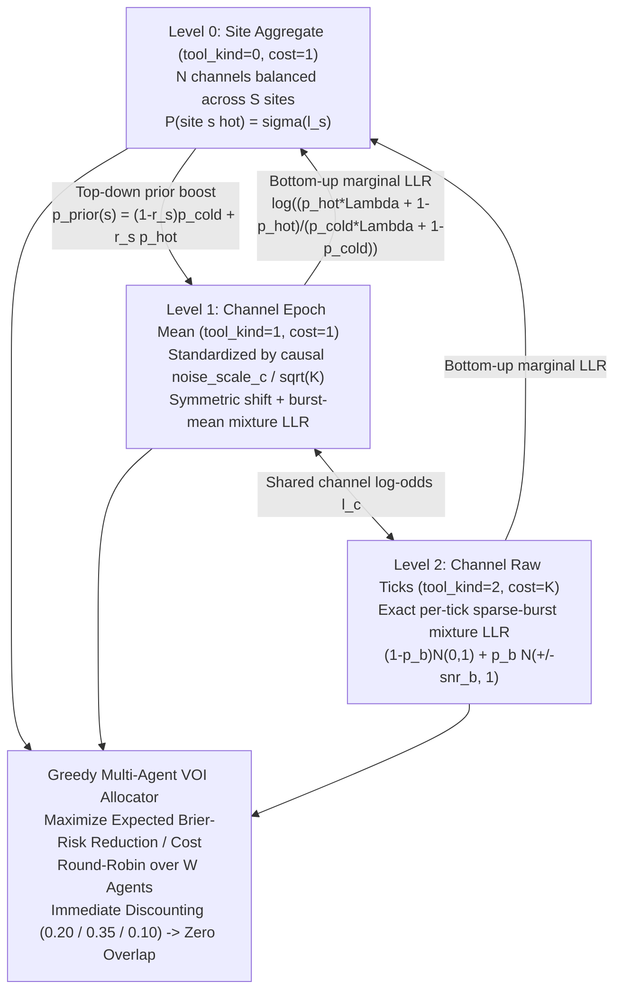

# `streamsieve` Technical Architecture & Mathematical Specification

> **Version:** `0.2.0`  
> **Runtime:** Zero-dependency C++20 (`-O3 -march=native -ffp-contract=off`, portable MSVC/Clang/GCC) with 8-wide cache-tiled AVX2 SIMD acceleration and an exception-free C ABI (`csrc/streamsieve_capi.h`).  
> **Scope of this document:** Verified mathematical formulations, algebraic invariants, SIMD/memory architecture, complexity bounds, and honest failure boundaries derived directly from `csrc/streamsieve_core.hpp`, `csrc/streamsieve_capi.h`, `csrc/streamsieve_capi.cpp`, and `csrc/streamsieve_cli.cpp`. Empirical benchmark tables are produced separately by `benchmarks/run_all.py` and are intentionally not duplicated or estimated here.

---

## 1. System Overview

`streamsieve` is a deterministic, strictly causal streaming inference runtime engineered for AI agents and multi-agent systems operating over high-frequency telemetry, metrics, and asynchronous tool outputs. It comprises **four co-designed engines** exposed through a single opaque-handle C ABI (`csrc/streamsieve_capi.h`):

1. **`EStreamEngine` (`ss_estream_t`)** — 8-wide cache-tiled AVX2 Structure-of-Arrays (SoA) dual-resolution anytime-valid e-process detector with optional causal deseasonalizing & detrending, exact online e-BH FDR control, and a lossless raw-tick drill-down ring buffer.
2. **`EvidenceLattice` (`ss_lattice_t`)** — State-based join-semilattice CRDT for provenance-deduplicated, echo-free multi-agent belief fusion with dual Bayesian log-odds and Vovk–Wang admissible e-value readouts plus a compact binary wire format (`SSLT` v1).
3. **`VOISifter` (`ss_sifter_t`)** — Hierarchical `site × channel × tick` mean-field Bayesian posterior tracker with exact sparse-burst mixture LLR and zero-overlap greedy Expected Brier-Risk Reduction allocation across multiple agents.
4. **`TrustCalibrator` (`ss_trust_t`)** — Strictly causal delayed-label agent weighting, non-negative online Platt shrinkage, discounted fixed-share BOA/Hedge, Ville e-value quarantine and shadow recovery martingales, multi-rate delayed AgACI conformal intervals, and Bayes-optimal cost-asymmetric actions.



### Runtime & ABI Foundations

| Property | Specification | Source |
|---|---|---|
| Compiler flags | `-std=c++20 -O3 -march=native -ffp-contract=off -Wall -Wextra -Wpedantic -fPIC` (plus `clang++ -Werror` & MSVC `/std:c++20 /O2 /fp:precise`) | `Makefile`, `setup.py` |
| Sanitizer verification | `-std=c++20 -O1 -g -fno-omit-frame-pointer -fsanitize=address,undefined,float-cast-overflow` | `Makefile` (`test-san`) |
| Floating-point determinism | `-ffp-contract=off` disables cross-target FMA contraction drift | `Makefile` |
| SIMD detection | Compile-time `#if defined(__AVX2__)` queried via `ss_has_avx2()` | `streamsieve_core.hpp`, `streamsieve_capi.cpp` |
| ABI exception safety | All `extern "C"` entry points (`SS_API`) catch all C++ exceptions and return status codes (`SS_OK = 0`, `SS_ERR_NULL = -1`, `SS_ERR_INVALID_ARG = -2`, `SS_ERR_OOM = -3`, `SS_ERR_BOUNDS = -4`, `SS_ERR_PARSE = -5`, `SS_ERR_BUFFER_SMALL = -6`) | `streamsieve_capi.h`, `streamsieve_capi.cpp` |
| Provenance hash | `ss_hash_provenance(data, len)`: 64-bit FNV-1a (`0xcbf29ce484222325 ^ len`, prime `0x100000001b3`) followed by SplitMix64 avalanche (`>>30`, `*0xbf58476d1ce4e5b9`, `>>27`, `*0x94d049bb133111eb`, `>>31`) | `streamsieve_core.hpp` |
| Normal quantile $\Phi^{-1}(p)$ | Acklam rational approximation `norm_ppf(p)` on $p \in [10^{-12}, 1-10^{-12}]$, max error $< 1.15 \times 10^{-9}$ | `streamsieve_core.hpp` |
| Safe transcendental helpers | `sigmoid_d(x)` clamped at $\pm 60$, `logit_d(p)` clamped to $[10^{-12}, 1-10^{-12}]$, `log_sum_exp(a, b)` with $d < -37$ 0-ULP skip, `fast_log1p_pos`, and `fast_xlogx[4097]` | `streamsieve_core.hpp` |

---

## 2. Engine 1: `EStreamEngine` — 8-Wide AVX2 Anytime-Valid Dual-Resolution E-Process & Online e-BH

**C Handle & Structs:** `ss_estream_t`, `ss_estream_config_t`, `ss_channel_status_t`  
**Core Class:** `streamsieve::EStreamEngine`

`EStreamEngine` monitors $M = \texttt{n\_channels}$ streams strictly causally (outputs at tick $t$ depend solely on $x[0 \dots t]$), optionally pre-filters diurnal seasonality (`season_period`) and trends/random walks (`detrend_alpha`), compresses firehose matrices into compact flagged briefs, supports continuous peeking at arbitrary stopping times without p-hacking inflation, and preserves bit-exact lossless raw tick drill-down.



### 2.1 Causal Pre-Filtering & Overflow-Free Winsorized-MAD Normalization

Lossless raw inputs $x_t$ are always pushed to the per-channel ring buffer *before* any pre-filtering so `fetch_raw` drill-down returns the exact unmodified stream.

- **Optional Stage 1 — Causal Detrender (`detrend_alpha` $\in (0, 1]$):**
  - `detrend_alpha = 1.0`: **causal first difference** $r_t = x_t - x_{t-1}$ (eliminates arbitrarily steep linear trends and unit-step random walks in 1 tick with 0 transient; slope breaks become sustained step shifts).
  - `0 < detrend_alpha < 1.0`: **EWMA high-pass filter** initialized from the **5-sample median** (`median5`, immune to up to 2 simultaneous $10^{15}$ warmup spikes) with clamped burn-in $\min(W_0, \lceil 3 / \max(\alpha, 10^{-6}) \rceil)$ ticks, intended for slow baseline drift rather than steep ramps.
- **Optional Stage 2 — Frozen Causal Per-Phase Deseasonalizer (`season_period` $P \in [2, 4096]$):**
  - Extends effective warmup to $W_{\text{eff}} = \max(W_0, 3P)$ ticks so every phase $p \in \{0, \dots, P-1\}$ collects at least 3 warmup samples.
  - At `finalize_warmup`, computes the per-phase median $\hat{s}_{c,p}$ (stored phase-major `[p * n_ch_ + c]` for contiguous SIMD loads) and freezes it permanently so post-warmup step shifts are never absorbed.
  - Applies an analytical out-of-sample median variance & in-sample DoF scale correction factor $\sqrt{\frac{1 + \pi/(2\bar{m})}{\max(1 - 1.55/\bar{m}, 0.25)}}$ where $\bar{m} = W_{\text{eff}}/P$, restoring exact OOS variance calibration.
- **Overflow-Free Winsorized-MAD Baseline (`finalize_warmup`):**
  1. Direct-sort exact median using `0.5 * lo + 0.5 * hi` (never overflows even on alternating $\pm 10^{308}$ inputs) and safe IQR `(q75 / 1.3489795) - (q25 / 1.3489795)`.
  2. Normalizes centered deviations by `robust_r` *before* Winsorizing to $[-3, +3]$ and squaring ($d_i^2 \le 9$, preventing `d * d` overflow on $\pm 10^{155}\text{–}10^{308}$ inputs), then scales back by `robust_r` and clamps `scale_[c]` to $[10^{-12}, 10^{300}]$.
  3. Zero per-channel heap allocations during warmup finalization via reusable member scratch vectors (`w_sorted_`, `w_tmp_`, `w_abs_`, `w_clip_`).

### 2.2 8-Wide Cache-Tiled AVX2 Batch & 4-Wide SIMD Row Hot Paths

All per-channel hot accumulators (`loc_`, `inv_scale_`, `last_z_`, `sum_u_`, `sum_u2_`, `sum_tail_`, `sum_tail2_`, `cnt_sign_`, `cnt_burst_`, `cnt_ext_burst_`) live in contiguous Structure-of-Arrays (SoA) `std::vector` buffers.

- **Primary `update_batch` Hot Path (`update_batch_tile_warm`):** Once all channels are warmed and synchronized (`sync_post_ == true`, no active detrend/season), `update_batch` tiles time into cache-friendly blocks (`max_tile = 16` for $M \ge 2048$, else `32`, clipped at checkpoint boundaries) to eliminate L1d set-associativity thrashing on power-of-2 channel strides (`1024`, `4096`).
  1. **8-channel (full 64-byte cache line) register-pinned loop:** Holds `vlz`, `vsu`, `vsu2`, `vst`, `vst2` in two `__m256d` register halves across the entire tile, prefetching 4 rows ahead for wide matrices (`stride >= 64`).
  2. **Branchless finiteness & packed 8×32-bit counters:** Accumulates `v_all_fin` across the tile with zero inner-loop branches and packs sign/burst/extreme-burst comparison masks from 8 doubles into single `__m256i` 8×32-bit counters via `_mm256_shuffle_ps(..., 0x88)` + `_mm256_sub_epi32` (lane permutation `{0,1,4,5,2,3,6,7}`). On any mid-tile `NaN`/`±Inf`, safely rolls back that 8-channel strip to exact scalar `update_one_impl` with 0-ULP parity.
  3. **4-wide AVX2 remainder + scalar epilogue** cover arbitrary non-multiple-of-8 channel counts (`1, 3, 5, 7, ...`) and non-AVX2 hosts bit-identically.
- **Per-Row `update_row_warm_simd` Path:** Processes 4 `double` lanes per iteration via `__m256d` (including contiguous SIMD seasonal subtraction and finiteness checks on both raw `x` and seasonal residual `x_eff`), clamping $z_c \in [-10^6, +10^6]$, applying the zero-transcendental algebraic squash $u_c = 0.4 z_c / \sqrt{1 + (0.4 z_c)^2} \in (-1, 1)$, and accumulating the tail hinge $h_c = \max(0, |u_c| - 0.55)$ and counters with $O(1)$ hoisted `sync_post_n_` tracking.
- **Query Acceleration (`flush_evalues`):** Caches shared `(n0, n1)` JZS geometry (`g0`, `g1`, `0.5*log(g0)`, `0.5*log(g1)`) across synchronized channels, replaces `std::log` in the Beta-Binomial pooled denominator with a 4,097-entry `fast_xlogx` table, precomputes all 5 static `log_beta` constants at initialization, and uses a zero-allocation `rank_scratch_` buffer with NaN-safe strict weak ordering (`rank_greater`).

### 2.3 Dual-Resolution Anytime-Valid E-Processes & Dyadic Checkpoint Mixture

To detect shifts or bursts starting at **any unknown changepoint $t^*$** while maintaining $O(1)$ ingestion cost per channel-tick, `EStreamEngine` records up to `kMaxCheckpoints = 24` cumulative snapshots (`Snap`) per channel on a $1.5\times$ geometric schedule:
$$n^{(0)} = \max(W_0, 24), \qquad n^{(k+1)} = n^{(k)} + \max\!\left(\left\lfloor n^{(k)} / 2 \right\rfloor,\; 16\right)$$
For default $W_0 = 32$, 24 snapshots place split candidates from post-warmup tick $32$ out past tick $358{,}438$ (covering $> 500\text{k}$ total ticks with post-split windows).

E-values are evaluated lazily in `recompute_channel_evalue(c)` over all recorded checkpoints $k \in \{0, \dots, n_{\text{snaps}} - 1\}$ with $n_1 = n_{\text{post}} - n_0 > 4$ using two building blocks:

#### (A) Two-Sample Universal-Inference Beta-Binomial E-Process (`log_e_two_sample_bernoulli`)
For binary event counts $(k_0, n_0)$ before split $k$ and $(k_1, n_1)$ after split $k$ (with $n_0 \ge 4, n_1 \ge 4$; total $k_t = k_0 + k_1, n_t = n_0 + n_1$):
$$E_{\text{BB}}(k_0, n_0; k_1, n_1) = \frac{m_{\text{BB}}(k_0, n_0; a_0, b_0)\cdot m_{\text{BB}}(k_1, n_1; a_1, b_1)}{\hat{p}^{k_t}(1 - \hat{p})^{n_t - k_t}}, \qquad \hat{p} = \frac{k_t}{n_t}$$
where $m_{\text{BB}}(k, n; a, b) = \frac{B(a+k,\, b+n-k)}{B(a, b)}$ is computed via `fast_lgamma` — an exact 16,385-entry quarter-integer lookup table covering $x \in \{0.25, 0.50, \dots, 4096.0\}$ with 0 ULP error versus `std::lgamma`, falling back to a 4-term Bernoulli–Stirling expansion for $x \ge 16$ and `std::lgamma` otherwise (and the denominator is $1$ when $k_t \in \{0, n_t\}$). When `one_sided_increase == true` and $k_1/n_1 \le k_0/n_0$, the log e-value is clamped to $-50.0$ ($E \approx 0$).

**Validity guarantee (Wasserman, Ramdas & Balakrishnan 2020; Turner, Ly & Grünwald 2024):** Under any stationary null $H_0: p_0 = p_1 = p \in [0, 1]$, the pooled MLE satisfies $\hat{p}^{k_t}(1-\hat{p})^{n_t-k_t} \ge p^{k_t}(1-p)^{n_t-k_t}$ pointwise for every $p$, while the numerator is a valid joint probability mass function over $(k_0, k_1)$ integrated against $\text{Beta}(a_0,b_0) \times \text{Beta}(a_1,b_1)$. Hence:
$$\mathbb{E}_{H_0}\!\left[E_{\text{BB}}\right] \le \sum_{k_0, k_1} m_{\text{BB}}(k_0, n_0; a_0, b_0)\, m_{\text{BB}}(k_1, n_1; a_1, b_1) = 1$$
for **every** stationary continuous or discrete base distribution (exact distribution-free validity, regardless of heavy tails or skewness).

#### (B) Two-Sample Group-Invariant JZS Sequential $t$-Test E-Process (`log_e_two_sample_jzs`)
For bounded transformed sums $(n_0, S_0, Q_0)$ and $(n_1, S_1, Q_1)$ (requiring $n_0 \ge 8, n_1 \ge 8$):
$$m_j = \frac{S_j}{n_j}, \quad \Delta = m_1 - m_0, \quad SS_j = \max(0, Q_j - n_j m_j^2), \quad \nu = n_0 + n_1 - 2$$
$$s_p^2 = \max\!\left(\frac{SS_0 + SS_1}{\nu},\; 10^{-6}\right), \quad n_{\text{eff}} = \frac{n_0 n_1}{n_0 + n_1}, \quad \frac{t^2}{\nu} = \frac{n_{\text{eff}}\Delta^2}{s_p^2 \nu}$$
Averaged equally over two effect-size scales $\tau_1 = 0.35, \tau_2 = 0.85$ with $g_i = 1 + n_{\text{eff}}\tau_i^2$:
$$E_{\text{JZS}} = \frac{1}{2}\sum_{i=1}^{2} c_{\text{side}}\cdot g_i^{-1/2}\left(\frac{1 + t^2/\nu}{1 + t^2/(\nu g_i)}\right)^{(\nu+1)/2}$$
where $c_{\text{side}} = 1$ for two-sided tests and $c_{\text{side}} = 2$ on $\Delta > 0$ (returning $\log E = -50.0$ on $\Delta \le 0$) for one-sided tests.

#### (C) Dual-Resolution Per-Checkpoint & Telescoping Mixture
At each valid checkpoint $k$:
- **Mean-shift component ($E_{m,k}$):**
  $$E_{m,k} = 0.5\, E_{\text{BB}}\!\big(\text{sign};\, a_0{=}0.5, b_0{=}0.5, a_1{=}0.5, b_1{=}0.5,\, \neg\texttt{two\_sided}\big) + 0.5\, E_{\text{JZS}}\!\big(u;\, \texttt{two\_sided}\big)$$
- **Tail-burst component ($E_{b,k}$, strictly one-sided increase):**
  $$E_{b,k} = 0.50\, E_{\text{JZS}}(h;\, \text{one-sided}) + 0.30\, E_{\text{BB}}\!\big(\text{ext\_burst};\, 0.25, 45.0, 0.75, 4.0\big) + 0.20\, E_{\text{BB}}\!\big(\text{burst};\, 0.5, b_{0,\text{tail}}, 1.0, 4.0\big)$$
  where $b_{0,\text{tail}} = \max\!\big(2.0,\; 0.5(1 - p_0)/p_0\big)$.
- **Summable telescoping checkpoint mixture:** Each checkpoint $k$ receives weight:
  $$\pi_k = \frac{1}{(k + 1)(k + 2)}, \qquad \sum_{k=0}^{\infty}\pi_k = \sum_{k=0}^{\infty}\left(\frac{1}{k+1} - \frac{1}{k+2}\right) = 1$$
  Unused weight $r = \max\!\big(0,\; 1 - \sum_{k \text{ active}} \pi_k\big)$ is placed on the trivial e-value $1$, preserving convexity at every tick:
  $$E_{\text{mean}} = r + \sum_{k} \pi_k E_{m,k}, \qquad E_{\text{burst}} = r + \sum_{k} \pi_k E_{b,k}, \qquad E_{\text{comb}} = \frac{1}{2} E_{\text{mean}} + \frac{1}{2} E_{\text{burst}}$$
  (clamped via $\exp(\min(\log E_{\text{comb}}, 700.0))$ to prevent overflow).
- **Mode & changepoint attribution:** `best_cp_tick_[c]` records $s_k.\text{tick}$ maximizing $\max(\log E_{m,k}, \log E_{b,k}) + \log \pi_k$. `mode_[c]` sets bit `0` (`1=mean_shift`) if $\log E_{\text{mean}} \ge \log(1/\alpha)$ and bit `1` (`2=burst`) if $\log E_{\text{burst}} \ge \log(1/\alpha)$ (`3=both`).

### 2.4 Exact Online e-BH FDR Control & Lossless Raw-Tick Ring

- **Wang & Ramdas (2022) e-BH (`ss_estream_ebh_reject`, `ss_estream_topk`, `ss_estream_get_channel`):**
  1. Lazily flushes all dirty channels (`flush_evalues`).
  2. Sorts $E_{(1)} \ge E_{(2)} \ge \dots \ge E_{(M)}$ descending (tie-broken deterministically by ascending channel index).
  3. Finds the largest $k^* \in \{1, \dots, M\}$ satisfying:
     $$E_{(k^*)} \ge \frac{M}{\alpha k^*}$$
  4. Rejects the top $k^*$ channels. Because e-BH relies only on $\mathbb{E}_{H_0}[E_c] \le 1$ and Markov's inequality, it guarantees $\operatorname{FDR} \le \alpha$ under **arbitrary cross-channel dependence** and **arbitrary data-dependent stopping times** (no Benjamini–Yekutieli $\log M$ penalty!).
  - *Exact cached threshold:* `ensure_ebh_cache()` caches the exact step-up threshold $M / (\alpha k^*)$ (invalidated on any `update_row`/`update_one`/`reset`), so `ss_estream_get_channel(st, c, &out)` sets `out.rejected_ebh` in $O(1)$ amortized time while agreeing **100% identically** with `ss_estream_ebh_reject` and `ss_estream_topk`.
- **Lossless raw-tick ring buffer (`ss_estream_fetch_raw`):**
  - Flat `n_ch_ * ring_cap_` circular buffer storing exact raw `double` values and `uint32_t` ticks (default `ring_capacity = 256`; set to `0` to disable ring storage and maximize pure streaming throughput).
  - Returns the most recent `min(ring_len_[c], max_out)` ticks in exact chronological order, enabling AI agents to inspect raw samples only for e-BH-flagged channels.

---

## 3. Engine 2: `EvidenceLattice` — Zero-Echo Join-Semilattice CRDT & Vovk–Wang E-Merger

**C Handle & Structs:** `ss_lattice_t`, `ss_evidence_item_t`, `ss_hyp_summary_t`  
**Core Class:** `streamsieve::EvidenceLattice`

In multi-agent systems with gossip, shared memory, or cyclic tool-result forwarding, naive Bayesian updating suffers catastrophic **echo-chamber double counting**: the same underlying observation reprinted by 5 agents gets added to log-odds 5 times. `EvidenceLattice` eliminates double counting algebraically via a state-based Join-Semilattice CRDT keyed by 64-bit `provenance_id`.



### 3.1 Semilattice State & Strict Total-Order Tie-Breaking

Each `EvidenceLattice` instance holds:
- `merge_mode_` $\in \{\texttt{SS\_MERGE\_STRICT\_ORIGIN (0)},\; \texttt{SS\_MERGE\_MAX\_RELIABILITY (1)}\}$
- `agent_weights_`: `std::map<uint32_t, double>` (ordered by `agent_id`, finite non-negative weights)
- `hyps_`: `std::map<uint64_t, HypState>` (ordered by `hyp_id`), where each `HypState` holds `(prior_log_odds, has_prior, echoes_suppressed, std::map<uint64_t, Entry> evidence)` keyed by `provenance_id`, with:
  ```cpp
  struct Entry {
      double   llr;
      double   log_e;
      uint32_t agent_id;
      uint32_t reliability_q16;
      uint64_t timestamp_ns;
  };
  ```
Only finite `llr` and `log_e` entries are accepted by `observe`. Duplicate `provenance_id` collisions increment the local diagnostic counter `echoes_suppressed` and resolve via a **strict total order** `entry_beats(a, b)`:

| Priority | `SS_MERGE_STRICT_ORIGIN` (`0`) | `SS_MERGE_MAX_RELIABILITY` (`1`) |
|---|---|---|
| 1 (Primary) | Smaller `timestamp_ns` (earliest origin) | Larger `reliability_q16` |
| 2 | Smaller `agent_id` | Smaller `timestamp_ns` |
| 3 | Larger `reliability_q16` | Smaller `agent_id` |
| 4 | Larger `llr` | Larger `llr` |
| 5 (Final) | Larger `log_e` | Larger `log_e` |

**Theorem (Bit-Exact Join-Semilattice CRDT):** Define the join $L_A \sqcup L_B$ (`merge_from`) as:
- Agent weights: pointwise key union, taking $\max(w_A, w_B)$ on shared `agent_id`.
- Hypothesis priors: adopt `has_prior` if present on one side, taking $\max(\text{prior}_A, \text{prior}_B)$ if both `has_prior`.
- Per-hypothesis evidence maps: key union over `provenance_id`, retaining $\max_{\text{entry\_beats}}(e_A, e_B)$ on collisions.

Because every finite tuple `(timestamp_ns, agent_id, reliability_q16, llr, log_e)` is totally ordered by `entry_beats`, every component join is **commutative** ($A \sqcup B = B \sqcup A$), **associative** ($(A \sqcup B) \sqcup C = A \sqcup (B \sqcup C)$), and **idempotent** ($A \sqcup A = A$, the **anti-echo law**). Furthermore, storing `evidence` in an ordered `std::map<uint64_t, Entry>` fixes floating-point summation in strictly ascending `provenance_id` order regardless of arrival or merge permutation, yielding **bit-for-bit identical** IEEE-754 outputs across all replicas.

### 3.2 Dual Statistical Readout (`ss_lattice_query`)

For a queried `hyp_id`, `EvidenceLattice::query` produces two complementary statistical summaries from the deduplicated provenance set $\mathcal{P}_h$:

1. **Deduplicated Bayesian Log-Odds (unique provenance):**
   $$\ell_{\text{total}}(h) = \ell_0(h) + \sum_{p \in \mathcal{P}_h} w_{a(p)}\,\text{LLR}_p, \qquad P(h) = \sigma\!\big(\ell_{\text{total}}(h)\big)$$
   where $w_a$ is `agent_weights_[a]` if configured (including $0.0$ to mute an agent) and $1.0$ otherwise. Valid as an exact Bayesian posterior when distinct provenance items are conditionally independent given $h$.

2. **Vovk–Wang Admissible Arithmetic E-Merging (arbitrary cross-agent dependence):**
   Even after provenance deduplication, different agents may still observe correlated signals or run overlapping analyses. First, within each distinct agent $a \in \mathcal{A}_h$, unique evidence items are combined multiplicatively in log space:
   $$\log E_a = \sum_{p \in \mathcal{P}_{h,a}} \log E_p$$
   Then, **across** distinct positively weighted agents $\mathcal{A}_h^+ = \{a \in \mathcal{A}_h : w_a > 0\}$ (where unset agents default to $w_a = 1.0$, and explicitly zero-weighted / quarantined agents with $w_a = 0.0$ are strictly excluded), per-agent e-values are fused via weighted arithmetic averaging (Vovk & Wang 2021 — the essentially unique symmetric admissible e-merging function valid under arbitrary unknown dependence):
   $$E_{\text{merged}}(h) = \sum_{a \in \mathcal{A}_h^+} \tilde{w}_a E_a, \qquad \tilde{w}_a = \frac{w_a}{\sum_{a' \in \mathcal{A}_h^+} w_{a'}}$$
   evaluated stably in log-space with `log_sum_exp` (returning neutral $\log E_{\text{merged}} = 0, E_{\text{merged}} = 1$ if $\mathcal{A}_h^+ = \emptyset$). `merged_e_value` is materialized as $\exp(\operatorname{clamp}(\log E_{\text{merged}}, -700, 700))$.

### 3.3 Compact Little-Endian Binary Wire Format (`SSLT` v1)

For tight byte-budget inter-agent synchronization, `ss_lattice_serialize` / `ss_lattice_deserialize` encode the full CRDT state (excluding the local-only diagnostic `echoes_suppressed` counter) into a compact binary stream. Deserialization strictly validates wire length bounds, `std::isfinite` on every IEEE-754 double (`weight`, `prior_log_odds`, `llr`, `log_e`), and `weight >= 0.0`, returning `nullptr` (`SS_ERR_PARSE`) on any corrupted or adversarial payload:

| Section | Field | Type | Bytes | Notes |
|---|---|---|---|---|
| **Header** (16 B) | `magic` | `char[4]` | 4 | ASCII `"SSLT"` |
| | `version` | `uint32_t` | 4 | `1` |
| | `merge_mode` | `uint32_t` | 4 | `0` (`STRICT_ORIGIN`) or `1` (`MAX_RELIABILITY`) |
| | `n_hyps` | `uint32_t` | 4 | Number of hypothesis blocks |
| **Weights** (`4 + 12·n_aw` B) | `n_aw` | `uint32_t` | 4 | Number of configured agent weights |
| | `(agent_id, weight)` × `n_aw` | `(u32, f64)` | `12 × n_aw` | Ascending `agent_id` |
| **Each Hypothesis** (`21 + 40·n_ev` B) | `hyp_id` | `uint64_t` | 8 | Ascending `hyp_id` |
| | `prior_log_odds` | `double` | 8 | Prior log-odds |
| | `has_prior` | `uint8_t` | 1 | `0` or `1` |
| | `n_ev` | `uint32_t` | 4 | Number of unique provenance items |
| | `(provenance_id, llr, log_e, agent_id, reliability_q16, timestamp_ns)` × `n_ev` | `(u64, f64, f64, u32, u32, u64)` | `40 × n_ev` | Ascending `provenance_id` |

Exact serialized size:
$$\text{Bytes}(L) = 20 + 12\,|\text{weights}| + \sum_{h \in H} \left(21 + 40\,|\mathcal{P}_h|\right)$$
Passing `out_buf = NULL` to `ss_lattice_serialize` computes exact required length in `*out_len` without allocating.

---

## 4. Engine 3: `VOISifter` — Hierarchical Multi-Agent Value-of-Information Attention

**C Handle & Structs:** `ss_sifter_t`, `ss_sifter_config_t`, `ss_voi_action_t`  
**Core Class:** `streamsieve::VOISifter`

When an agent fleet faces $N$ channels under strict token or read budgets, scanning raw ticks everywhere wastes tokens while reading only coarse averages misses sparse bursts and falls for high-variance "loud channels." `VOISifter` solves budgeted multi-resolution attention via a 3-tier hierarchical Bayesian model (`site × channel × tick`).



### 4.1 Hierarchical Model & Causal Noise-Scale Normalization

$N = \texttt{n\_channels}$ channels are partitioned evenly across $S = \operatorname{clamp}(\texttt{n\_sites}, 1, N)$ contiguous non-empty sites with exact boundaries $[\lfloor s N / S \rfloor,\; \lfloor (s+1) N / S \rfloor)$ and exact inverse mapping $s(c) = \lfloor ((c + 1) S - 1) / N \rfloor$ (every site has size $m_s \in \{\lfloor N/S \rfloor, \lceil N/S \rceil\} \ge 1$, avoiding empty trailing sites even for non-divisible pairs such as $N=7, S=5$). Default priors: $p_{\text{cold}} = 0.02$, $r_0 = 0.10$, $p_{\text{hot}} = 0.25$, $\mu_s = 1.5$, $p_b = 0.15$, $\mu_b = 2.5$, $K = \texttt{ticks\_per\_epoch} = 8$. All floating-point configuration fields are sanitized via `sanitize_cfg` so `NaN` inputs safely fall back to valid defaults.

Each channel has a causal noise scale $\sigma_c > 0$ configured via `ss_sifter_set_noise_scales` (defaults to $1.0$; non-finite or $\le 10^{-12}$ safely reset to $1.0$). All observations divide by $\sigma_c$, granting **complete loud-channel immunity**.

**Mean-field hierarchical coupling:**
- Effective posterior for channel $c$ (`effective_channel_prob`):
  $$r_s = \begin{cases}\sigma(\ell_s) & S > 1 \\ 0 & S = 1\end{cases}, \qquad p_{\text{prior}}(s) = (1 - r_s)\, p_{\text{cold}} + r_s\, p_{\text{hot}}$$
  $$p_c = \sigma\!\Big((\ell_c - \operatorname{logit}(p_{\text{cold}})) + \operatorname{logit}\big(p_{\text{prior}}(s)\big)\Big)$$
- Bottom-up channel-to-site propagation (`propagate_channel_to_site`): whenever channel $c$ receives log-likelihood ratio $\lambda_c$ (clamped to $[-20, 20]$), its parent site $s(c)$ receives the exact marginal log-likelihood ratio of observing that channel evidence under a hot site versus a cold site:
  $$\Delta \ell_s = \log\!\left(\frac{p_{\text{hot}}\, e^{\lambda_c} + (1 - p_{\text{hot}})}{p_{\text{cold}}\, e^{\lambda_c} + (1 - p_{\text{cold}})}\right), \qquad \ell_s \leftarrow \operatorname{clamp}(\ell_s + \Delta \ell_s, -20, 20)$$

### 4.2 Exact Likelihood Ratios Across All Three Granularities

1. **Site aggregate (`ss_sifter_observe_site_agg`, `tool_kind = 0`, `cost = 1`):**  
   For site $s$ with $m_s$ channels, aggregate null variance $\sigma_{\text{agg}}^2 = \max\!\left(\frac{1}{m_s^2}\sum_{c \in s}\frac{\sigma_c^2}{K},\; 10^{-12}\right)$, average scale $\bar{\sigma}_s = \frac{1}{m_s}\sum_{c \in s}\sigma_c$, and expected hot-site shift $\mu_{\text{hot}} = (p_{\text{hot}} - p_{\text{cold}})\max(\mu_s, p_b \mu_b)\bar{\sigma}_s$:
   $$\text{LLR}_{\text{site}}(y) = \log\!\left(\frac{1}{2}\exp\!\left(\frac{y\mu_{\text{hot}} - \frac{1}{2}\mu_{\text{hot}}^2}{\sigma_{\text{agg}}^2}\right) + \frac{1}{2}\exp\!\left(\frac{-y\mu_{\text{hot}} - \frac{1}{2}\mu_{\text{hot}}^2}{\sigma_{\text{agg}}^2}\right)\right)$$
   added to $\ell_s$ (clamped to $[-20, 20]$).

2. **Channel epoch mean (`ss_sifter_observe_mean`, `tool_kind = 1`, `cost = 1`):**  
   Standardizes $z = \bar{x}_c / (\sigma_c / \sqrt{K})$, evaluates symmetric Gaussian LLRs at both $\mu_{\text{shift}} = \mu_s\sqrt{K}$ and $\mu_{\text{burst}} = p_b\mu_b\sqrt{K}$, takes their equal $0.5/0.5$ mixture in log-space, updates $\ell_c \leftarrow \operatorname{clamp}(\ell_c + \text{LLR}, -25, 25)$, and propagates upward to site $s(c)$.

3. **Channel raw ticks (`ss_sifter_observe_ticks`, `tool_kind = 2`, `cost = K`):**  
   Standardizes each finite tick $z_i = x_{c,i} / \sigma_c$ and evaluates the **exact per-tick sparse-burst mixture LLR** against $\mathcal{N}(0, 1)$ alongside the sustained-shift LLR:
   $$\log \Lambda_{\text{burst}}^{\pm} = \sum_{i=1}^{n_{\text{ticks}}} \log\!\left((1 - p_b) + p_b \exp\!\left(\pm z_i \mu_b - \frac{1}{2}\mu_b^2\right)\right), \qquad \log \Lambda_{\text{shift}}^{\pm} = \sum_{i=1}^{n_{\text{ticks}}}\left(\pm z_i \mu_s - \frac{1}{2}\mu_s^2\right)$$
   Takes a symmetric $0.5/0.5$ mixture over sign ($\pm$) and $0.5/0.5$ over burst vs. shift, adds to $\ell_c$ (clamped to $[-25, 25]$), and propagates upward to site $s(c)$. This captures sparse bursts (e.g., 1–2 ticks at $3.5\sigma$ out of 8) whose epoch average would otherwise look calm.

### 4.3 Greedy Expected Brier-Risk Reduction & Zero-Overlap Multi-Agent Partitioning

`ss_sifter_allocate` computes non-overlapping inspection plans for $W = \texttt{n\_agents}$ agents, each with attention budget `budget_per_agent`:

- **Tool information-gain coefficients:**
  $$\text{SNR}_{\text{mean}} = \max(\mu_s, p_b \mu_b)\sqrt{K}, \qquad I_{\text{mean}} = 1 - \exp(-0.35\,\text{SNR}_{\text{mean}}^2)$$
  $$\text{SNR}_{\text{tick}} = \max\!\big(\mu_s\sqrt{K},\; \mu_b\sqrt{p_b K}\big), \qquad I_{\text{tick}} = 1 - \exp(-0.45\,\text{SNR}_{\text{tick}}^2)$$
- **Initial uncertainty discounts from prior observations:**
  $$d_c = 0.55^{\#\text{mean}_c} \cdot 0.25^{\#\text{tick}_c}, \qquad d_s = 0.35^{\#\text{site}_s}$$
- **Expected Brier-risk reduction per unit attention cost:**
  - Site aggregate (`cost = 1`, if `allow_site_agg && S > 1`):
    $$\text{VOI}_{\text{site}}(s) = m_s\cdot r_s(1 - r_s)\, d_s\cdot (p_{\text{hot}} - p_{\text{cold}})^2 \cdot 2.5$$
  - Channel mean (`cost = 1`, if `allow_mean`):
    $$\text{VOI}_{\text{mean}}(c) = p_c(1 - p_c)\, I_{\text{mean}}\, d_c$$
  - Channel raw ticks (`cost = K`, if `allow_ticks && rem_budget[a] >= K`):
    $$\text{VOI}_{\text{tick}}(c) = \frac{p_c(1 - p_c)\, I_{\text{tick}}\, d_c}{K}$$
- **Round-robin immediate discounting:** Iterating round-robin over agents $a = 0, \dots, W - 1$, each agent selects the feasible action with highest $\text{VOI} > 10^{-12}$, deducts its cost, and **immediately discounts** the chosen target's simulated uncertainty (`site_disc[s] *= 0.20`, `ch_disc[c] *= 0.35` for mean, `ch_disc[c] *= 0.10` for ticks). Consequently, agent $a+1$ automatically routes to the next highest-VOI uninspected target, achieving **zero-overlap multi-agent partitioning** in a single planning pass.
- **Epoch decay (`ss_sifter_step_epoch`):** For non-stationary regimes, transitions each channel posterior via $p_{\text{next}} = p\cdot s_p + (1 - p)(1 - s_p)\, p_{\text{cold}}$ with $s_p = \operatorname{sanitize\_cfg}(\texttt{stay\_prob}, 0.99, 0.5, 1.0)$.

---

## 5. Engine 4: `TrustCalibrator` — Delayed-Label Trust, Quarantine & Conformal Action

**C Handle & Structs:** `ss_trust_t`, `ss_trust_config_t`, `ss_agent_trust_t`, `ss_trust_decision_t`  
**Core Class:** `streamsieve::TrustCalibrator`

Real agent ensembles suffer from four coupled failure modes: (i) delayed and out-of-order ground truth, (ii) overconfident uncalibrated "bloviator" agents, (iii) abrupt regime flips or actively poisoned Byzantine agents, and (iv) asymmetric operational costs. `TrustCalibrator` addresses all four strictly causally.

```mermaid
sequenceDiagram
    participant Agents as W Agents (prob or mean/std; NaN=abstain)
    participant TC as TrustCalibrator
    participant Pending as Causal Pending Map (cap 65,536)
    participant Env as Delayed Ground Truth

    Agents->>TC: predict_prob / predict_scalar (decision_id, cu, co)
    Note over TC: Apply causal Platt (prob mode)<br/>Fuse active (non-quarantined) weights w_i<br/>Compute AgACI interval [ci_low, ci_high]<br/>Compute Bayes-optimal cost-asymmetric action
    TC->>Pending: Freeze PendingPred[decision_id]
    TC-->>Agents: ss_trust_decision_t (fused, CI, optimal_action)

    Note over Env: Arbitrary delay / out-of-order arrival
    Env->>TC: resolve(decision_id, outcome y)
    Pending-->>TC: Pop & erase PendingPred[decision_id]
    Note over TC: 1. Bounded loss in [0,1] + non-negative Platt update (a in [0,3])<br/>2. 2nd-order BOA + Fixed-Share mixing (alpha_fs)<br/>3. Leave-one-out peer ref + 0.08 slack Ville quarantine (e >= 20)<br/>4. Raw-loss shadow recovery (e >= 5) + Platt/weight reset<br/>5. Multi-rate AgACI (4 gammas) + 256-residual window
```

### 5.1 Strictly Causal Delayed-Label Join Buffer

- Every call to `ss_trust_predict_prob` or `ss_trust_predict_scalar` stores a frozen `PendingPred` snapshot (`is_prob`, `fused_point`, `fused_std`, `raw_vals`, `cal_vals`) inside `std::map<uint64_t, PendingPred> pending_` keyed by `decision_id`. **Zero state updates occur at prediction time.**
- Agents may abstain on any decision by passing `NaN` (non-finite values are skipped in both prediction and resolution).
- `ss_trust_resolve(tc, decision_id, outcome)` handles arbitrary out-of-order label arrivals by looking up and erasing `pending_[decision_id]` (returning `SS_ERR_BOUNDS` if unknown or already evicted).
- Memory is strictly bounded by `trim_pending()`: whenever `pending_.size() > 65536`, the oldest entry (lowest `decision_id`) is evicted.

### 5.2 Non-Negative Online Platt Shrinkage & Byzantine-Safe Losses

- **Probability mode (`predict_prob`):** Raw probabilities are clamped to $[10^{-6}, 1-10^{-6}]$ and transformed causally via per-agent Platt scaling:
  $$\hat{p}_i = \sigma\!\big(a_i \operatorname{logit}(p_i) + b_i\big)$$
  Upon resolution with $y \in [0, 1]$, each participating agent incurs the strictly proper Brier loss $\ell_i = (\hat{p}_i - y)^2 \in [0, 1]$ (plus raw Brier loss $\ell_i^{\text{raw}} = (p_i - y)^2$), and its Platt parameters update via $L_2$-regularized online logistic SGD on the clamped raw logit $l_i = \operatorname{clamp}(\operatorname{logit}(p_i), -8, 8)$:
  $$a_i \leftarrow \operatorname{clamp}\!\Big(a_i - \eta_{\text{platt}}\big((\sigma(a_i l_i + b_i) - y) l_i + \lambda_{\text{l2}} a_i\big),\; 0.0,\; 3.0\Big)$$
  $$b_i \leftarrow \operatorname{clamp}\!\Big(b_i - \eta_{\text{platt}}\big((\sigma(a_i l_i + b_i) - y) + \lambda_{\text{l2}} b_i\big),\; -3.0,\; 3.0\Big)$$
  The **non-negative slope constraint $a_i \ge 0$** is critical for Byzantine safety: an adversarial agent cannot oscillate polarity to exploit a learned negative slope, while the $L_2$ penalty pulls overconfident random bloviators smoothly toward $a_i \to 0$ (neutral predictions).
- **Continuous scalar mode (`predict_scalar`):** Fuses active agents via mixture moment matching:
  $$\hat{\mu} = \frac{\sum_{i \notin Q} w_i \mu_i}{\sum_{i \notin Q} w_i}, \qquad \hat{\sigma} = \sqrt{\max\!\left(\frac{\sum_{i \notin Q} w_i (s_i^2 + \mu_i^2)}{\sum_{i \notin Q} w_i} - \hat{\mu}^2,\; 10^{-12}\right)}$$
  (falling back to `score_scale_ema_` when an agent omits `agent_stds`). Upon resolution, `score_scale_ema_` updates via `0.90 * score_scale_ema_ + 0.10 * max(|y - fused_point|, 1e-6)`, and each agent receives a Huber-bounded relative squared loss in $[0, 1)$:
  $$e_i = \frac{|\mu_i - y|}{\max(\texttt{score\_scale\_ema\_}, 10^{-6})}, \qquad \ell_i = \left(\frac{e_i}{1 + e_i}\right)^2 \in [0, 1)$$
  bounding the influence of arbitrarily extreme ($\pm 10^{12}$) Byzantine scalar forecasts.

### 5.3 Discounted Fixed-Share BOA/Hedge & Leave-One-Out Ville Quarantine / Shadow Recovery

1. **Second-order Fixed-Share BOA/Hedge:** Let $\ell_{\text{boa}} = \bar{\ell}_{\text{act}}$ be the active-weighted average loss (falling back to the median loss across participating agents if no active agent participated), and $d_i^{\text{boa}} = \ell_i - \ell_{\text{boa}}$:
   $$\text{step}_i = \operatorname{clamp}\!\left(\eta\, d_i^{\text{boa}} + \frac{1}{2}\eta^2 (d_i^{\text{boa}})^2,\; -3.0,\; 3.0\right), \qquad w_i^{\text{raw}} = \max\!\big(w_i e^{-\text{step}_i},\; 10^{-12}\big)$$
   Active (non-quarantined) weights are normalized and mixed with a uniform fixed-share floor $\alpha_{\text{fs}}$ (default `0.04`), while **every quarantined agent unconditionally receives $w_i = 0$** (including when all agents are quarantined):
   $$w_i \leftarrow \begin{cases} 0 & \text{if } i \in Q \\ (1 - \alpha_{\text{fs}})\dfrac{w_i^{\text{raw}}}{\sum_{j \notin Q} w_j^{\text{raw}}} + \dfrac{\alpha_{\text{fs}}}{|A|} & \text{if } i \notin Q \end{cases}$$
   Fixed-share mixing prevents weights from collapsing permanently to zero, enabling rapid recovery after abrupt agent skill flips.
2. **Leave-one-out Ville e-value quarantine (for active agents):** For each participating active agent $i$, compute the strictly unbiased leave-one-out active peer mean $\bar{\ell}_{-i}$ (or neutral baseline $0.25$ if $i$ is the sole active agent). To prevent inverted Byzantine probability agents from hiding behind Platt shrinkage ($a_i \to 0 \implies \ell_i = 0.25$) without penalizing underconfident honest agents, set $\ell_i^{q} = \max(\ell_i, \ell_i^{\text{raw}})$ when `is_prob` and $\ell_i^{\text{raw}} > 0.30$ (and $\ell_i^{q} = \ell_i$ otherwise). Subtracting explicit null slack $m = 0.08$ guarantees strictly negative drift $\mathbb{E}[\log(1 + 0.8 d_{\text{clip}})] < 0$ across identical honest agents:
   $$d_{\text{clip}} = \operatorname{clamp}\!\big(\ell_i^{q} - \bar{\ell}_{-i} - 0.08,\; -1,\; 1\big), \qquad \log E_i^{\text{quar}} \leftarrow \max\!\Big(0,\; \log E_i^{\text{quar}} + \log\max(1 + 0.8\, d_{\text{clip}}, 10^{-6})\Big)$$
   Agent $i$ is quarantined (`quarantined_[i] = 1`, `weights_[i] = 0.0`) once $\log E_i^{\text{quar}} \ge \log(\Gamma_{\text{quar}})$ (default $\Gamma_{\text{quar}} = 20.0$) and `n_resolved_[i] >= 5`.
3. **Raw-loss shadow recovery (for quarantined agents):** Quarantined agents continue to be scored silently on their unshrunk raw loss $\ell_i^{\text{raw}}$ against $\theta_{\text{rec}} = \min(0.22,\; \bar{\ell}_{\text{act}} + 0.10)$:
   $$r_i = \operatorname{clamp}\!\big(\theta_{\text{rec}} - \ell_i^{\text{raw}},\; -0.5,\; 0.5\big), \qquad \log E_i^{\text{rec}} \leftarrow \max\!\Big(0,\; \log E_i^{\text{rec}} + \log\max(1 + 1.8\, r_i, 10^{-6})\Big)$$
   Using $\ell_i^{\text{raw}}$ prevents still-inverted agents (whose $a_i = 0$ would yield $\ell_i = 0.25$) from gaming recovery while allowing genuinely repaired agents to recover rapidly even alongside strong bystander peers. Once $\log E_i^{\text{rec}} \ge \log(\Gamma_{\text{rec}})$ (default $\Gamma_{\text{rec}} = 5.0$), agent $i$ is re-admitted (`quarantined_[i] = 0`, `quarantine_log_e_[i] = 0.0`, `recovery_log_e_[i] = 0.0`), its Platt slope is restored to $\max(a_i, 0.8)$ if $\ell_i^{\text{raw}} < \ell_i$, and its raw weight is seeded to $\max(w_i^{\text{raw}}, 0.25)$ before normalization.
4. If *every* agent is simultaneously quarantined, all stored weights are strictly $0.0$, and prediction gracefully falls back to the unweighted mean of finite predictions (`0.5` / `0.0` if all abstain).

### 5.4 Multi-Rate Delayed AgACI Conformal Intervals & Bayes-Optimal Cost-Asymmetric Action

- **Multi-rate Delayed AgACI (`update_aci`):** Runs $R = 4$ parallel Adaptive Conformal Inference experts with step sizes $\gamma_r \in \{0.005, 0.02, 0.08, 0.20\}$ targeting miscoverage $\alpha = \texttt{conformal\_alpha}$ (default `0.10`, i.e., 90% coverage). On each resolved residual $|y - \hat{\mu}|$:
  1. Computes miscoverage indicator $\text{err}_t = \mathbf{1}\{|y - \hat{\mu}| > \text{half\_w}\}$.
  2. Evaluates pinball loss $\rho_\alpha(\text{err}_t, \alpha_{t,r}) = (\text{err}_t - \alpha_{t,r})(1 - \alpha)$ if $\text{err}_t > \alpha_{t,r}$ else $(\alpha_{t,r} - \text{err}_t)\alpha$, updates expert weights $v_r \leftarrow v_r \exp(-0.5\,\rho_\alpha)$ (renormalized), and steps $\alpha_{t+1,r} = \operatorname{clamp}(\alpha_{t,r} + \gamma_r(\alpha - \text{err}_t),\; 0.001,\; 0.95)$.
  3. Aggregates effective miscoverage target $\alpha_{\text{eff}} = \operatorname{clamp}(\sum_{r=1}^{4} v_r \alpha_{t,r},\; 0.002,\; 0.95)$ and maintains a sliding window of the latest 256 absolute residuals (`residual_hist_`), returning the empirical $\lceil(1 - \alpha_{\text{eff}})n\rceil$-th order statistic $q_{\text{margin}}$ (default `0.25` when empty).
  4. Emits crossing-free intervals:
     - Scalar mode: $\text{half\_w} = \max\!\big(\Phi^{-1}(1 - 0.5\alpha_{\text{eff}})\,\hat{\sigma},\; q_{\text{margin}}\big)$, $\text{CI} = [\hat{\mu} - \text{half\_w},\; \hat{\mu} + \text{half\_w}]$.
     - Probability mode: $\text{CI} = [\operatorname{clamp}(\hat{p} - q_{\text{margin}}, 0, 1),\; \operatorname{clamp}(\hat{p} + q_{\text{margin}}, 0, 1)]$.
- **Bayes-optimal cost-asymmetric action:** Given underage cost $c_u > 0$ and overage cost $c_o > 0$:
  - **Continuous scalar mode (newsvendor quantile):**
    $$\tau^* = \frac{c_u}{c_u + c_o}, \qquad a^* = \hat{\mu} + \Phi^{-1}(\tau^*)\,\hat{\sigma}$$
    For example, a $4:1$ underage-to-overage ratio targets the $80\text{th}$ percentile ($\tau^* = 0.80$).
  - **Binary probability mode (Bayes risk threshold):** Minimizing expected cost $(1-p)c_o$ for acting vs. $p c_u$ for not acting yields the exact dual rule:
    $$\theta^* = \frac{c_o}{c_u + c_o}, \qquad a^* = \mathbf{1}\!\left\{\hat{p}_{\text{fused}} \ge \theta^*\right\}$$
    At $4:1$ underage-to-overage cost, the optimal binary decision triggers once $\hat{p}_{\text{fused}} \ge 0.20$.

---

## 6. Complexity & Memory Bounds

Let $M$ = channels, $W_0$ = warmup ticks, $R_{\text{ring}}$ = ring capacity, $C \le 24$ = checkpoints, $|H|$ = hypotheses, $P$ = total unique provenance entries, $W$ = agents, $S$ = sites, $K$ = ticks per epoch, $B$ = total allocated actions.

| Engine & Operation | Time Complexity | Memory Footprint |
|---|---|---|
| `EStreamEngine::update_row` (post-warmup SIMD) | $O(M / 4)$ AVX2 ops (amortized $O(1)$ per channel-tick) | $O(M(W_0 + R_{\text{ring}} + C))$ ($\approx 1.7\text{ KB/ch}$ at $W_0{=}32, R_{\text{ring}}{=}0$; $+3.0\text{ KB/ch}$ at $R_{\text{ring}}{=}256$) |
| `EStreamEngine::ebh_reject` / `topk` | $O(M_{\text{dirty}}\cdot C + M \log M)$ | $O(M)$ transient ranking vector |
| `EStreamEngine::fetch_raw` | $O(\min(R_{\text{ring}}, \texttt{max\_out}))$ | Zero allocation |
| `EvidenceLattice::observe` | $O(\log |H| + \log |\mathcal{P}_h|)$ | $O(|H| + P + W)$ |
| `EvidenceLattice::merge_from` | $O((|H_B| + P_B)\log(|H_A| + P_A))$ | $O(|H_A \cup H_B| + |P_A \cup P_B|)$ |
| `EvidenceLattice::query` | $O(|\mathcal{P}_h| \log W)$ | $O(W)$ per-agent accumulator map |
| `EvidenceLattice::serialize` | $O(|H| + P + W)$ | $20 + 12W + \sum_h(21 + 40|\mathcal{P}_h|)$ bytes |
| `VOISifter::observe_site_agg` | $O(N / S)$ | $O(N + S)$ |
| `VOISifter::observe_mean` | $O(1)$ | $O(N + S)$ |
| `VOISifter::observe_ticks` | $O(n_{\text{ticks}})$ | $O(N + S)$ |
| `VOISifter::allocate` | $O(B \cdot (N + S))$ | $O(N + S + W + B)$ |
| `TrustCalibrator::predict_*` | $O(W + \log|\text{pending}| + r\log r)$, $r \le 256$ | $O(W + |\text{pending}|)$, $|\text{pending}| \le 65{,}536$ |
| `TrustCalibrator::resolve` | $O(\log|\text{pending}| + W\log W + r\log r)$ | Bounded by 65,536 pending map cap + 256 residuals |

---

## 7. Honest Scope & Failure Boundaries

Rigorous engineering requires stating exactly where statistical and architectural guarantees hold — and where they break down.

1. **Warmup window $W_{\text{eff}}$ & baseline contamination (`EStreamEngine`):**
   - No betting or e-value accumulation occurs during the first $W_{\text{eff}} = \max(\texttt{warmup}, 12, 3P)$ ticks (default 32 when `season_period == 0`), nor until the first snapshot is recorded at post-warmup tick $n^{(0)} = \max(W_0, 24)$ plus at least 5 post-split ticks (`n1 > 4`; and `n1 >= 8` for the JZS component). Thus, under default `warmup = 32, season_period = 0`, the earliest non-trivial combined e-value occurs at tick $32 + 32 + 5 = 69$.
   - A permanent regime shift occurring *inside* the warmup window becomes part of the baseline $(\hat{\mu}_c, \hat{\sigma}_c)$ and will not be flagged as a post-warmup changepoint.
   - Although `ss_estream_config_t` reserves `ewma_reset_decay`, v0.2.0 keeps $(\hat{\mu}_c, \hat{\sigma}_c)$ fixed after warmup so sustained step shifts are never absorbed; enable `detrend_alpha` (`1.0` for linear ramps/random walks, or `0 < alpha < 1` for slow drift) when baselines drift over time.

2. **Minimum baseline sample size $n_0$ & wide-panel e-BH power on sparse bursts (`EStreamEngine`):**
   - Under online e-BH across $M$ channels with only $k^*$ active signals, rejection requires $E_{(k^*)} \ge M / (\alpha k^*)$ (e.g., $E \ge 20{,}000$ for 1 active channel out of $M = 1{,}000$ at $\alpha = 0.05$).
   - Because the Beta-Binomial e-process must estimate the unknown baseline burst rate $p_0$ from the pre-split window $n_0$ (universal inference denominator), **too small a pre-split baseline $n_0$ limits maximum achievable burst e-values** on rare spikes: when $n_0 = 32$ and $k_0 = 0$, a small pre-split denominator limits evidence growth until $n_0$ and $n_1$ accumulate enough samples. For very wide panels ($M \ge 1{,}000$) monitoring rare bursts ($p_b \le 0.05$), ensure sufficient baseline ticks before onset or pair `EStreamEngine` with hierarchical `VOISifter` site-level triage.

3. **Stationary null assumption & built-in causal pre-filter boundaries (`EStreamEngine`):**
   - Exact anytime-valid null calibration ($\mathbb{E}_{H_0}[E_\tau] \le 1$) holds for **i.i.d. or exchangeable stationary** streams (including heavy-tailed Student-$t$, skewed LogNormal, $10^{10}$ DC offsets, and $1000\times$ scale heterogeneity).
   - For **diurnal/periodic** streams with known integer period $P \in [2, 4096]$, enable `season_period = P` (uses 3+ warmup cycles to freeze per-phase medians with analytical OOS variance scaling). For **arbitrarily steep linear trends or unit-step random walks**, enable `detrend_alpha = 1.0` (causal first difference, 0 transient). Values `0 < detrend_alpha < 1` run a 5-sample-median-initialized EWMA high-pass filter suitable for slow drift (converging in $\approx 3/\alpha$ ticks), not steep ramps.
   - **Failure mode:** Streams with non-integer or time-varying seasonal periods or strong positive AR($p$) autocorrelation without pre-filtering violate exchangeability and should be residualized externally before feeding `EStream`.

4. **Checkpointing horizon (`EStreamEngine`):**
   - `kMaxCheckpoints = 24` places snapshots on a $\sim 1.5\times$ geometric grid out to $\sim 3.6 \times 10^5$ post-warmup ticks (at default `warmup = 32`). Streams running for millions of ticks still accumulate valid evidence against snapshot 24, but a late changepoint at tick $10^7$ will mix pre-change and post-change samples inside the post-snapshot window $n_1$, diluting detection speed unless the engine is periodically reset on validated regime boundaries.

5. **Provenance integrity, memory growth & endianness (`EvidenceLattice`):**
   - Deduplication guarantees zero double counting **only when identical underlying observations share the same `provenance_id`** (e.g., via deterministic content hashing with `ss_hash_provenance`). A Sybil adversary fabricating distinct `provenance_id`s for copied content is outside the CRDT scope and must be mitigated via `TrustCalibrator` quarantine and per-agent weighting.
   - `EvidenceLattice` retains all unique provenance items in memory (`O(P)`); v0.2.0 does not perform automatic TTL pruning or tombstone compaction.
   - In `query`, Bayesian log-odds assumes unique provenance items are conditionally independent given $h$; when cross-agent dependence cannot be ruled out, rely on `merged_e_value` (Vovk–Wang arithmetic mean). Setting an agent's weight to `0.0` via `set_agent_weight` strictly mutes both its LLR and Vovk–Wang `merged_e_value` contributions.
   - `SSLT` v1 serialization copies IEEE-754 doubles and integers directly via `std::memcpy`, assuming little-endian hosts (standard on x86_64 and ARM64).

6. **Parametric priors & myopic allocation (`VOISifter`):**
   - `VOISifter` assumes channel observations standardized by `noise_scale_` are approximately unit-variance Gaussian under the null and follow the configured `(shift_snr, burst_prob, burst_snr)` alternatives. Grossly mis-specified noise scales or heavy-tailed non-Gaussian outliers can skew posterior log-odds.
   - `allocate` performs myopic greedy selection (one-step expected Brier-risk reduction per unit cost with heuristic uncertainty discounts `0.20 / 0.35 / 0.10`), not multi-step POMDP lookahead.

7. **Pending cap, CUSUM trade-off, scalar Platt & Byzantine breakdown (`TrustCalibrator`):**
   - **65,536 pending decision cap:** Unresolved decisions beyond `65,536` are evicted oldest-ID-first (`trim_pending`); resolving an evicted ID returns `SS_ERR_BOUNDS`.
   - **CUSUM-reflected quarantine martingale:** Reflecting $\log E_i^{\text{quar}}$ at $0$ gives rapid Page/Lorden detection of agents that turn malicious mid-stream, at the standard CUSUM trade-off that over an infinite stationary horizon the expected time to a false quarantine is finite (controlled by $\Gamma_{\text{quar}}$, default `20.0`, and minimum 5 resolved labels), while shadow recovery ($\Gamma_{\text{rec}} = 5.0$) automatically re-admits transiently penalized honest agents.
   - **Byzantine breakdown point (< 50%):** Because `ref_loss` anchors on the median participating agent loss, `TrustCalibrator` isolates up to $49\%$ simultaneously poisoned agents; if $\ge 50\%$ of active agents collude maliciously on the same decision, the median benchmark itself is corrupted.
   - **Platt recalibration applies to probability mode only:** Continuous scalar predictions are weighted via BOA/Hedge and bounded by Huber relative loss, without affine bias/scale recalibration.
   - **Conformal coverage under severe delay/shift:** Multi-rate AgACI adapts rapidly across four step sizes ($\gamma \in \{0.005, 0.02, 0.08, 0.20\}$) over a 256-residual window, providing long-run coverage tracking rather than finite-sample exchangeable guarantees during abrupt distribution shifts or long label delays.

8. **Concurrency model (all engines):**
   - Engine handles (`ss_estream_t`, `ss_lattice_t`, `ss_sifter_t`, `ss_trust_t`) are **not internally mutex-locked**. Multi-threaded callers must synchronize access to a shared handle or instantiate per-agent handles and reconcile beliefs asynchronously via `ss_lattice_merge`.
