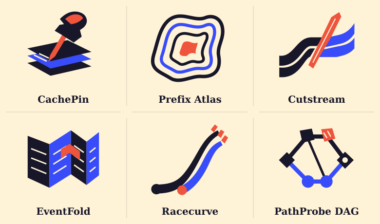
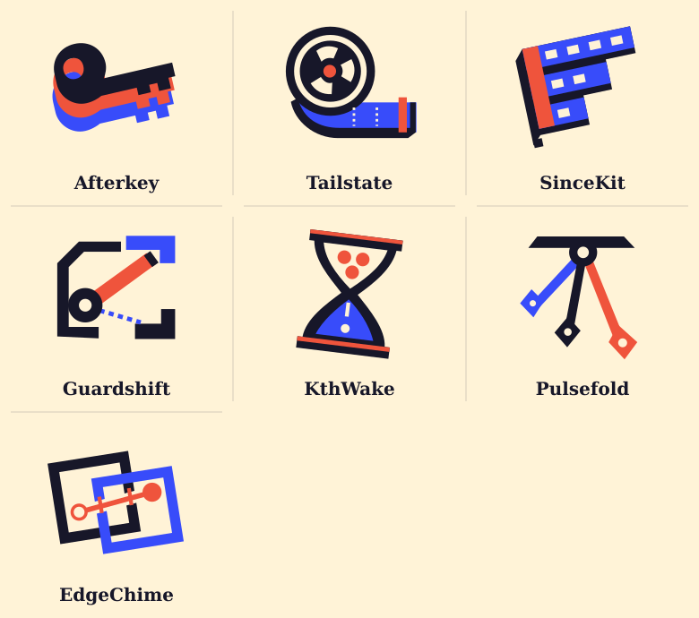
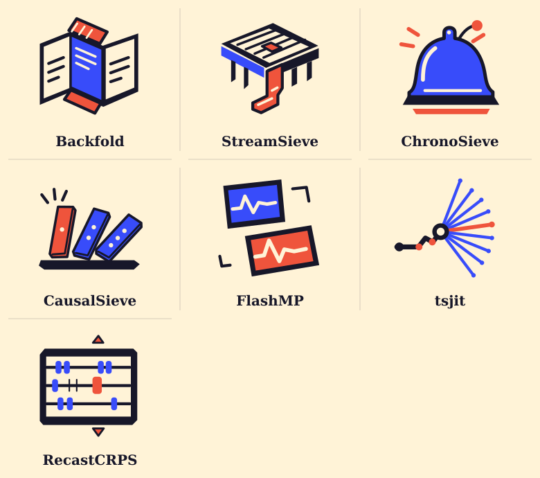
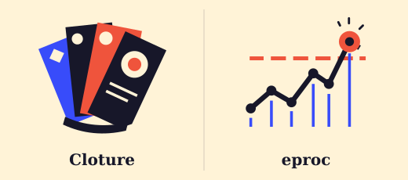

# PGG Engineering product marks

Choose a tool by the operation you need. Each product has editable vector artwork, source and a working example.

[View or print all 25 product marks](sheets/all-products.svg)

## Search and retrieval


| Product | What it does | Links |
| --- | --- | --- |
| [RankPatch](https://github.com/pgg898200-ship-it/rankpatch) | Replace one ranked list. Read the revised top k. | [Example](https://huggingface.co/spaces/pgg-engineering/rankpatch) · [Artwork](motifs/rankpatch.svg) |
| [RankSeal](https://huggingface.co/spaces/pgg-engineering/rankseal/tree/main) | Prove the ordered top k while results arrive in pages. | [Example](https://huggingface.co/spaces/pgg-engineering/rankseal) · [Artwork](motifs/rankseal.svg) |
| [RankFence](https://github.com/pgg898200-ship-it/streamsieve/tree/rankfence-mcp-0.1.0) | Use a shard map to stop rank fusion once the top k is settled. | [Example](https://rankfence-pgg.tancurl3.chatgpt.site/workbench.html) · [Artwork](motifs/rankfence.svg) |

## LLM serving and workflow latency



| Product | What it does | Links |
| --- | --- | --- |
| [CachePin](https://github.com/pgg898200-ship-it/cachepin) | Build reusable prompt prefixes and choose cache breakpoints. | [Example](https://pgg898200-ship-it.github.io/cachepin/) · [Artwork](motifs/cachepin.svg) |
| [Prefix Atlas](https://github.com/pgg898200-ship-it/cachepin/tree/main/tools/prefix-atlas) | Size a prefix cache for a target hit rate on a recorded serving trace. | [Example](https://huggingface.co/spaces/pgg-engineering/prefix-atlas) · [Artwork](motifs/prefix-atlas.svg) |
| [Cutstream](https://github.com/pgg898200-ship-it/cachepin/tree/main/cutstream) | Catch stop strings that cross response chunks. | [Example](https://github.com/pgg898200-ship-it/cachepin/blob/main/cutstream/examples/gateway.py) · [Artwork](motifs/cutstream.svg) |
| [EventFold](https://github.com/pgg898200-ship-it/backfold/tree/eventfold-v0.1/companions/eventfold) | Send each SSE frame as edits to its predecessor. Restore the exact bytes. | [Example](https://huggingface.co/spaces/pgg-engineering/eventfold) · [Artwork](motifs/eventfold.svg) |
| [Racecurve](https://github.com/pgg898200-ship-it/cachepin/tree/racecurve) | Test a backup request delay against paired latency traces. | [Example](https://huggingface.co/spaces/pgg-engineering/racecurve) · [Artwork](motifs/racecurve.svg) |
| [PathProbe DAG](https://github.com/pgg898200-ship-it/causalsieve/tree/main/tools/pathprobe) | Change one task’s duration. See when the whole workflow finishes. | [Example](https://huggingface.co/spaces/pgg-engineering/pathprobe-dag) · [Artwork](motifs/pathprobe-dag.svg) |

## State replication and event routing



| Product | What it does | Links |
| --- | --- | --- |
| [Afterkey](https://github.com/pgg898200-ship-it/streamsieve/tree/main/afterkey) | Catch up a reader with one value or deletion per key written since its cursor. | [Example](https://huggingface.co/spaces/pgg-engineering/afterkey) · [Artwork](motifs/afterkey.svg) |
| [Tailstate](https://github.com/pgg898200-ship-it/streamsieve/tree/afterkey-tailstate-0.1.0/afterkey/companions/tailstate) | Page through changed keys after a worker reconnects. | [Example](https://github.com/pgg898200-ship-it/streamsieve/blob/afterkey-tailstate-0.1.0/afterkey/companions/tailstate/examples/reconnect.py) · [Artwork](motifs/tailstate.svg) |
| [SinceKit](https://huggingface.co/spaces/pgg-engineering/sincekit/tree/main) | Prepare one changed-key array for readers at different revisions. | [Example](https://huggingface.co/spaces/pgg-engineering/sincekit) · [Artwork](motifs/sincekit.svg) |
| [Guardshift](https://github.com/pgg898200-ship-it/chronosieve/tree/releases/guardshift/guardshift) | Find the conditions that turned on or off after a batch of updates. | [Example](https://huggingface.co/spaces/pgg-engineering/guardshift) · [Artwork](motifs/guardshift.svg) |
| [KthWake](https://github.com/pgg898200-ship-it/chronosieve/tree/releases/kthwake-0.1.0/companions/kthwake) | Report when an event count crosses a threshold inside a sliding time window. | [Example](https://pgg-kthwake.tancurl3.chatgpt.site/) · [Artwork](motifs/kthwake.svg) |
| [Pulsefold](https://github.com/pgg898200-ship-it/streamsieve/tree/pulsefold-v0.1.0/pulsefold) | Detect stale heartbeats for readers with different deadlines. | [Example](https://huggingface.co/spaces/pgg-engineering/pulsefold) · [Artwork](motifs/pulsefold.svg) |
| [EdgeChime](https://github.com/pgg898200-ship-it/streamsieve/tree/main/edgechime) | Find which rectangular zones a moving point just entered or left. | [Example](https://huggingface.co/spaces/pgg-engineering/edgechime) · [Artwork](motifs/edgechime.svg) |

## Telemetry, time series and forecasts



| Product | What it does | Links |
| --- | --- | --- |
| [Backfold](https://github.com/pgg898200-ship-it/backfold) | Correct or retract a past event and update the online statistic. | [Example](https://pgg898200-ship-it.github.io/backfold/) · [Artwork](motifs/backfold.svg) |
| [StreamSieve](https://github.com/pgg898200-ship-it/streamsieve) | Sift numeric channels. Return a brief with handles for closer inspection. | [Example](https://github.com/pgg898200-ship-it/streamsieve/blob/main/examples/jsonl_diurnal_sre.py) · [Artwork](motifs/streamsieve.svg) |
| [ChronoSieve](https://github.com/pgg898200-ship-it/chronosieve) | Detect a distribution shift and send a compact digest to a downstream reader. | [Example](https://github.com/pgg898200-ship-it/chronosieve/blob/main/examples/alarm_escalation.py) · [Artwork](motifs/chronosieve.svg) |
| [CausalSieve](https://github.com/pgg898200-ship-it/causalsieve) | Rank likely upstream contributors to a telemetry incident. | [Example](https://pgg898200-ship-it.github.io/causalsieve/) · [Artwork](motifs/causalsieve.svg) |
| [FlashMP](https://github.com/pgg898200-ship-it/flashmp) | Find recurring or unusual subsequences with an exact matrix profile. | [Example](https://github.com/pgg898200-ship-it/flashmp/blob/main/examples/audit_tsfm_leakage.py) · [Artwork](motifs/flashmp.svg) |
| [tsjit](https://github.com/pgg898200-ship-it/tsjit) | Compile a forecasting model for a specified context and prediction horizon. | [Example](https://github.com/pgg898200-ship-it/tsjit/blob/main/llms.txt) · [Artwork](motifs/tsjit.svg) |
| [RecastCRPS](https://github.com/pgg898200-ship-it/streamsieve/tree/main/integrations/recastcrps) | Update an ensemble forecast’s CRPS when a member prediction changes. | [Example](https://huggingface.co/spaces/pgg-engineering/recastcrps) · [Artwork](motifs/recastcrps.svg) |

## Evaluation and sequential decisions



| Product | What it does | Links |
| --- | --- | --- |
| [Cloture](https://github.com/pgg898200-ship-it/cloture) | Stop a fixed-budget vote when the remaining judges cannot change the winner. | [Example](https://pgg898200-ship-it.github.io/cloture/playground.html) · [Artwork](motifs/cloture.svg) |
| [eproc](https://github.com/pgg898200-ship-it/eproc) | Track evidence as individual or paired evaluation scores arrive. | [Example](https://pgg898200-ship-it.github.io/eproc/) · [Artwork](motifs/eproc.svg) |

## Visual rules

Ink (`#171729`) carries type and outlines. Paper (`#fff3d7`) supplies the field and negative space. Cobalt (`#384cfa`) distinguishes a second shape or state. Vermilion (`#ef543c`) draws attention to a change. Pair color with shape or position. Local DejaVu Serif sets names, Sans sets captions, and Sans Mono sets categories and addresses. Each has a system fallback. Use the individual mark for a square thumbnail.

A mark identifies one product operation. A figure showing a measured result needs a labeled scale, units, and a trace or benchmark source. Use motion when the sequence explains the operation. A control response often takes 180–350 ms. An expanded sequence may need up to about two seconds. Play it once. With reduced motion, show the completed state immediately. Keep the same result visible in the static image and its text description.

## Reuse a mark

The SVGs in [motifs](motifs) scale to any size. Their adjacent JSON files describe the artwork for screen readers. [products.json](products.json) contains each card’s caption and destinations. The family sheets above also work in print.

From this directory, run one of these commands with Python 3.9 or later. SVG generation uses the standard library. PNG export uses a local copy of Inkscape or librsvg’s `rsvg-convert`.

```sh
python3 render.py --product rankpatch --out build
python3 render.py --spaces --png --out build
python3 render.py --index
```

Each card is 1200 × 630. The output directory contains one folder per product, with the card and its plain-text image description under `art/`. Omit `--product` and `--spaces` to export the full collection.

The [live tool index](https://pgg898200-ship-it.github.io/cachepin/tools/) uses the same catalogue, captions and marks. To rebuild the page in a CachePin checkout, run:

```sh
python3 render_web.py /path/to/cachepin/site/tools/index.html
```
