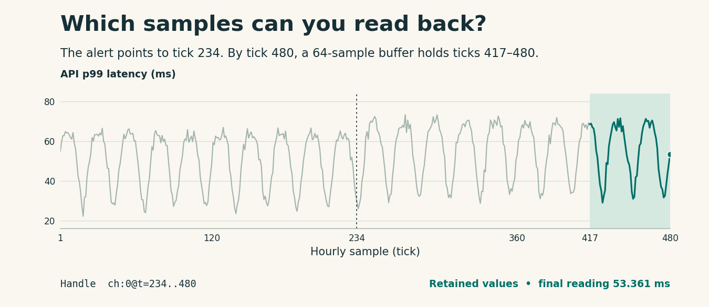

# StreamSieve examples

## Find a latency shift in JSON Lines

The [service telemetry example](jsonl_diurnal_sre.py) generates 480 hourly records for six metrics. Halfway through, API latency rises and database locks start to spike. Each metric also has a daily cycle.

From the repository root, [install the current source](../README.md#build-the-current-source), then run:

```sh
python3 examples/jsonl_diurnal_sre.py
```

The monitor flags one channel, `api_p99_ms`. The database spikes stay below the alert threshold. The alert handle leads back to the original latency measurements, ending at **53.361 ms at tick 480**.

```text
STREAMSIEVE BRIEF | 6 ch x 480 ticks | e-BH(alpha=0.050): 1/6 flagged
```



The handle is `ch:0@t=234..480`. The example keeps 64 raw samples per channel, so the earliest reading it can still return is tick 417. Increase `ring_capacity` to keep a longer history.

The example uses the same [JSON Lines reader](../python/streamsieve/formats.py) as the CLI and MCP server. To process your own flat JSON objects, run `streamsieve sift your-metrics.jsonl`.

## More examples

| Example | What to run or inspect |
|---|---|
| [Multi-agent pipeline](multi_agent_pipeline.py) | Run `python3 examples/multi_agent_pipeline.py` to assign inspections, merge duplicate evidence and update trust after an outcome arrives. |
| [NOAA weather observations](noaa_weather.csv) | The CLI and forecast examples below use daily measurements from Seattle and New York, 2012–2015. |

## Quick CLI & Python Snippets

### 1. Native CLI Sift on JSONL Logs & Real NOAA Telemetry (`<4 ms` cold start)

```bash
# Auto-detect JSONL/NDJSON logs with diurnal deseasonalizing
tail -n 2000 metrics.jsonl | streamsieve sift --season 24 --alpha 0.05 --json -

# Detrend linear ramps or random walks (1.0 = causal first difference)
cat cpu_trend.csv | streamsieve sift --detrend 1.0 --alpha 0.05 -

# Extract Seattle numeric columns (precipitation, temp_max, temp_min, wind) and sift
awk -F, 'NR==1 || $1=="Seattle" {print $3","$4","$5","$6}' examples/noaa_weather.csv \
  | streamsieve sift --alpha 0.05 --top 4 -

# Emit strict RFC-8259 JSON brief
awk -F, 'NR==1 || $1=="Seattle" {print $3","$4","$5","$6}' examples/noaa_weather.csv \
  | streamsieve sift --alpha 0.05 --top 4 --json -
```

### 2. Real-Data Delayed-Label AgACI & Cost-Asymmetric Action (`act` Probe)

Reproduce the real NOAA Seattle `temp_max` experiment with 4 forecasters (1-day delayed causal resolution, 4:1 underage:overage cost ratio):

```bash
python3 -c '
import csv
from streamsieve import TrustCalibrator

with open("examples/noaa_weather.csv", newline="") as f:
    temps = [float(r["temp_max"]) for r in csv.DictReader(f) if r["location"] == "Seattle"]

tc = TrustCalibrator(n_agents=4, conformal_alpha=0.10)
ema, alpha_e = temps[0], 0.25
cost_opt = cost_mean = covered = n = 0.0

for t in range(1, len(temps)):
    y_prev, y_true = temps[t - 1], temps[t]
    ema = alpha_e * y_prev + (1.0 - alpha_e) * ema
    # 4 forecasters: persistence, EMA, biased (+4 C), and inverted outlier
    means = [y_prev, ema, y_prev + 4.0, -y_prev]
    stds = [2.5, 2.5, 3.0, 4.0]
    dec = tc.predict_scalar(t, means, agent_stds=stds, underage_cost=4.0, overage_cost=1.0)
    if t >= 31:
        def asym_loss(a, y):
            return 4.0 * max(0.0, y - a) + 1.0 * max(0.0, a - y)
        cost_opt += asym_loss(dec.optimal_action, y_true)
        cost_mean += asym_loss(dec.fused_point, y_true)
        covered += 1.0 if dec.ci_low <= y_true <= dec.ci_high else 0.0
        n += 1.0
    tc.resolve(t, y_true)  # 1-day delayed causal resolution

print(f"Optimal action cost: {cost_opt/n:.3f} vs Point-mean: {cost_mean/n:.3f} ({(1 - cost_opt/cost_mean)*100:.2f}% saved)")
print(f"90% AgACI coverage: {covered/n*100:.2f}% | Agents: {[(a.agent_id, round(a.weight, 3), a.quarantined) for a in tc.agents()]}")
tc.close()
'
```

### Merge overlapping deadline reports from multiple collectors

Two collectors can report the same missed heartbeat. `pulsefold_lattice.py` counts unique expiry and recovery transitions from Pulsefold's scalar replay or live output. Each input goes into its own `EvidenceLattice` before the example merges the replicas. PGG Engineering maintains both projects. [Pulsefold release](https://pulsefold.tancurl3.chatgpt.site)

Run this offline from the StreamSieve root on a supported native build. The two collectors below see three rows each and overlap on two transitions.

```sh
make lib
tmpdir=$(mktemp -d)
printf '9 0 0 stale\n10 0 0 fresh\n15 0 0 stale\n' > "$tmpdir/collector-a"
printf '10 0 0 fresh\n15 0 0 stale\n22 0 1 stale\n' > "$tmpdir/collector-b"
PYTHONPATH=python python3 examples/pulsefold_lattice.py --source 'lab:epoch1:ttl5,12' \
  --tick-ns 1000000 "$tmpdir/collector-a" "$tmpdir/collector-b"
```

Expected output is `{"input_rows": 6, "unique": {"stale": 3, "fresh": 1}, "duplicate_rows": 2}`. Omit the paths to read `TIME FEED SUBSCRIBER stale|fresh` on stdin. `--tick-ns` is 1,000 for microsecond replay ticks or 1,000,000 for Pulsefold live milliseconds. Live replicas must share the same timestamp origin. Separately launched live monitors have independent origins, so collect the same monitor’s output or normalize the clocks first.

Use one `--source` for copies sharing an epoch, feed map and subscriber policy. Change it when a clock restarts or these definitions change. Provenance uses StreamSieve's 64-bit hash of the source, timestamp, feed, subscriber and transition kind. Each observation has neutral `llr=0` and `log_e=0` because it records a deadline event. The example keeps one record per unique transition in a bounded capture and emits its counts at EOF. Its `ingest()` function also accepts an existing lattice for wire sync using `to_bytes()` and `from_bytes()`.
